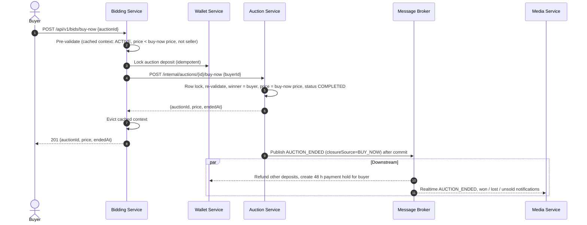

# Auction Closure & Winner Selection Flow

```mermaid
sequenceDiagram
    autonumber
    participant Job as Scheduler / CRON
    participant AS as Auction Service
    participant BS as Bidding Service
    participant DB_AS as Auction DB
    participant MQ as Message Broker
    participant WS as Wallet Service
    participant DB_WS as Wallet DB
    participant NS as Media Service
    actor Users as Winner & Losers

    Note over Job, Users: Automated Auction Closure Process
    
    Job->>AS: Trigger check for expired auctions
    AS->>DB_AS: Find Auctions where end_time <= NOW and status = ACTIVE
    
    loop For each expired auction
        AS->>AS: Mark status = CLOSING
        
        %% Get Winner
        AS->>BS: Get highest bid for AuctionID
        BS-->>AS: Return highest bid details (WinnerID, Amount)
        
        alt No Bids
            AS->>DB_AS: Update status = FAILED / CANCELLED
            AS->>MQ: Publish AUCTION_CANCELLED (no bids)
        else Has Winner
            AS->>DB_AS: Update status = ENDED_WAITING_PAYMENT, set WinnerID
        AS->>WS: POST /api/v1/wallets/auctions/{id}/settle (Settle deposits)
        WS->>DB_WS: Release Losers' deposits
        WS->>DB_WS: Convert Winner's deposit to HOLD
        WS-->>AS: 200 OK
        
        AS->>MQ: Publish AUCTION_ENDED_WITH_WINNER (For notifications)
    end
    
    %% Post-closure Async Processes
    par Notification Handling
        MQ-->>NS: Consume AUCTION_ENDED_WITH_WINNER
        NS->>Users: Send WebSocket "Auction Ended" updates
        NS->>Users: Send Email "You Won!" (to Winner)
        NS->>Users: Send Email "You Lost" (to Losers)
    end
```

## Closure via Buy It Now

A buyer can end an `ACTIVE` auction early at its `buy_now_price`. The closure source is `BUY_NOW` (alongside `SCHEDULER` and `ADMIN`); the downstream flow (refund losers, 48 h payment hold, notifications) is identical.



If the auction-service call loses a race (another buy-now, a bid reaching the price, a scheduled close or a cancel), the buyer gets `AUCTION_NOT_OPEN` or `BUY_NOW_NOT_AVAILABLE`; the deposit lock stays as a registration and is refunded by the auction-ended or auction-cancelled consumer, provided the lock landed before that sweep.
