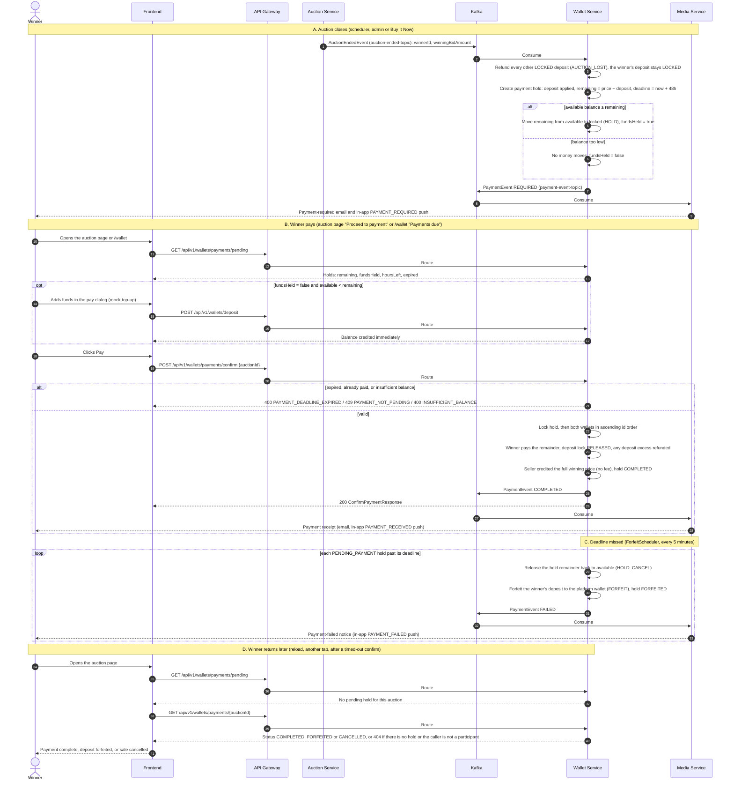

# Winner Payment & Forfeit Flow

Applies to a win by bid or by Buy It Now. Phase 1: wallet top-up is a mock (instant credit); real gateway is Phase 2. There is no platform fee on a sale.

The frontend refetches pending payments when a `PAYMENT_REQUIRED`, `PAYMENT_RECEIVED` or `PAYMENT_FAILED` push arrives. A returning winner's panel reads the final state from `GET /api/v1/wallets/payments/{auctionId}`: wallet-service owns the payment facts and auction-service does not record payment (its `winner_paid_at` and `payment_deadline` columns stay unused). Revisit only if auction-service needs the paid fact for its own features.
