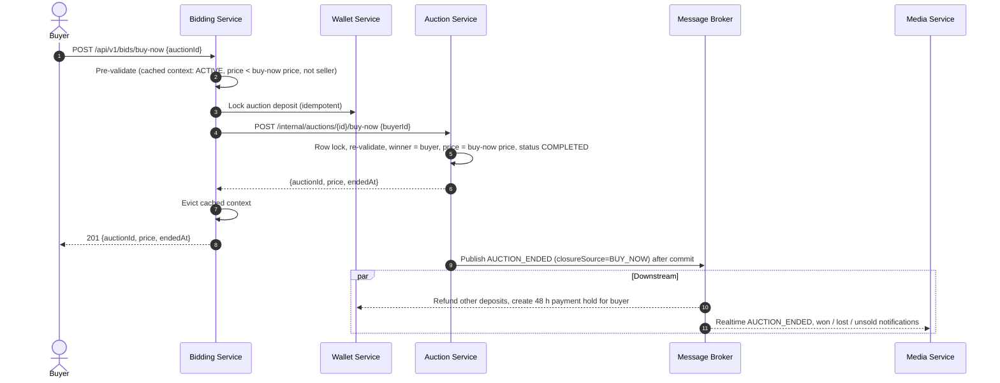

# Buy It Now Implementation Plan

> **For agentic workers:** REQUIRED SUB-SKILL: Use superpowers:subagent-driven-development (recommended) or superpowers:executing-plans to implement this plan task-by-task. Steps use checkbox (`- [ ]`) syntax for tracking.

**Goal:** A buyer can end a live auction immediately at the seller's `buyNowPrice`, locking the auction deposit and becoming the winner, so the existing 48 h payment hold takes over.

**Architecture:** bidding-service exposes `POST /api/v1/bids/buy-now` and orchestrates (pre-validate from the cached `BidContext` → `DepositGate.ensureLocked` → call auction-service). auction-service exposes an internal `POST /api/v1/internal/auctions/{id}/buy-now` that re-validates under `findByIdForUpdate`, completes the auction at `buyNowPrice` and publishes `AuctionEndedEvent` with `closureSource=BUY_NOW` after commit. Wallet, media and the cache-eviction consumer are reused unchanged. The frontend wires the dead "Buy Now →" button to a confirmation dialog, a new service call and a live-state reducer.

**Tech Stack:** Java 17 / Spring Boot 3 (JUnit 5, Mockito, AssertJ, Cucumber), OpenFeign, Kafka, Redis; Next.js 16 / TypeScript / Zustand / Base UI + shadcn `Dialog` / Vitest.

**Spec:** `docs/superpowers/specs/2026-10-14-buy-it-now-design.md`

## Global Constraints

- **Branch:** all work happens on `feature/buy-it-now`, created from `develop` (`CONTRIBUTING.md` format `feature/<feature-name>`). Confirm with `git branch --show-current` before starting; do not work on `develop` or `main`.
- **No commits.** The project owner's standing preference is to never commit unless explicitly asked, so this plan has no commit steps. Leave all changes in the working tree.
- No database migration and no schema change (`auction_items.buy_now_price` already exists; no bid row is written for a buy-now).
- Error codes (exact strings): `AUCTION_NOT_FOUND` 404, `AUCTION_NOT_OPEN` 409, `BID_OWN_AUCTION` 403, `BUY_NOW_NOT_AVAILABLE` 409 (new). Wallet errors come from the existing `DepositGate`.
- Public endpoint: `POST /api/v1/bids/buy-now`, header `X-User-Id`, body `{"auctionId": "<uuid>"}`, response `201` with `BaseResponse<{auctionId, price, endedAt}>`. Internal endpoint: `POST /api/v1/internal/auctions/{id}/buy-now`, body `{"buyerId": "<uuid>"}`, response `200` with `BaseResponse<{auctionId, price, endedAt}>`.
- Event: `AuctionEndedEvent` with `closureSource = "BUY_NOW"`, `winnerId = buyerId`, `winningBidAmount = buyNowPrice`, `loserIds = List.of()`, real `totalBids`.
- Availability rule (both services): auction `ACTIVE`, `now < endTime`, buyer is not the seller, `buyNowPrice != null` and `currentPrice < buyNowPrice`. `currentPrice == buyNowPrice` is **not** available.
- `BidContext` (bidding) and `BidContextResponse` (auction) field names must stay identical: the new field is `buyNowPrice` (`BigDecimal`, nullable).
- auction-service's internal transaction timeout stays `@Transactional(timeout = 1)` (below bidding's 2 s Feign read timeout), like `applyBid`.
- Frontend amounts are dollars (`number`); compare with `lib/money.ts`, display with `formatCurrency` in `font-mono`; never `any`; use existing shadcn `Dialog` / `Button` (no hand-written primitives).
- Deploy order: auction-service → bidding-service → frontend.
- Backend build/test commands run from `backend/` with `mvn`. If a module cannot resolve `common`, run `mvn clean install -pl common -DskipTests` once, then retry.
- Out of scope: wiring `BidPanelEnded` payment buttons, Buy-It-Now-specific notification copy, idempotent retry, any change to `buyNowPrice` validation at create/update.

## Review Focus

Failure modes the spec implies; each has a test in the named task.

1. **Boundaries:** `currentPrice == buyNowPrice` and `now == endTime` must be rejected (Task 1 service tests, Task 3 validation tests).
2. **Current leader buys now:** their deposit is already locked; the purchase must still succeed and the gate call stays idempotent (Task 1, Task 5).
3. **Stale cache from a rolling deploy:** a cached context without `buyNowPrice` must trigger one refresh, then `BUY_NOW_NOT_AVAILABLE` if still null (Task 3 JSON test, Task 5).
4. **Deposit locked, then auction-service rejects or is unreachable:** the cache is evicted, the mapped error reaches the client, and the buyer is not stuck (Task 5, Task 4).
5. **Double submit / retry after success:** a second call gets `AUCTION_NOT_OPEN` (Task 1); the dialog cannot be re-confirmed or dismissed while the request runs (Task 9); the later realtime `AUCTION_ENDED` is a no-op on top of the local result (Task 8).

---

## File Structure

**auction-service** (`backend/auction-service/src/main/java/com/bidnow/auction/`)
- Modify `constant/AuctionErrorCodes.java` — add `BUY_NOW_NOT_AVAILABLE`.
- Modify `dto/response/BidContextResponse.java` — add `buyNowPrice`.
- Create `dto/request/BuyNowRequest.java`, `dto/response/BuyNowResponse.java`.
- Modify `service/AuctionBidService.java` — map `buyNowPrice` in `getBidContext`; add `applyBuyNow`; new `AuctionStatusHistoryRepository` dependency.
- Modify `controller/AuctionInternalController.java` — new `POST /{id}/buy-now`.
- Tests: modify `service/AuctionBidServiceTest.java`, `controller/AuctionInternalControllerTest.java`.

**bidding-service** (`backend/bidding-service/src/main/java/com/bidnow/bidding/`)
- Modify `constant/BiddingErrorCodes.java`, `dto/BidContext.java`, `service/BidValidationService.java`, `feign/AuctionServiceClient.java`, `service/AuctionBidGateway.java`, `controller/BidController.java`.
- Create `dto/BuyNowCommand.java`, `dto/BuyNowResult.java`, `dto/request/BuyNowRequest.java`, `dto/response/BuyNowResponse.java`, `service/BuyNowService.java`.
- Tests: modify `BidValidationServiceTest`, `BidContextJsonTest`, `AuctionBidGatewayTest`, `BidControllerTest`, `BidControllerSecurityTest`, bdd `BidPlacementSteps` + `place-bid.feature`; create `BuyNowServiceTest`.

**frontend** (`frontend/`)
- Modify `types/api/bid.api.ts`, `services/bid.service.ts`, `lib/bid-errors.ts`, `lib/realtime/auction-live.ts`, `store/auctionStore.ts`, `components/auction/BidPanelLive.tsx`, `components/auction/index.ts`.
- Create `components/auction/BuyNowButton.tsx`, `lib/realtime/test-fixtures.ts`.
- Tests (Vitest, node env, `**/*.test.ts`): create `services/bid.service.test.ts`, `lib/bid-errors.test.ts`, `lib/realtime/auction-live.test.ts`, `store/auctionStore.test.ts`.

**docs**: modify `docs/architecture.md`, `docs/diagrams/04-auction-closure-flow.md`, `docs/business-clarifications.md`, `docs/functional.md`.

---

### Task 1: auction-service — bid-context field and `applyBuyNow`

**Files:**
- Modify: `backend/auction-service/src/main/java/com/bidnow/auction/constant/AuctionErrorCodes.java`
- Modify: `backend/auction-service/src/main/java/com/bidnow/auction/dto/response/BidContextResponse.java`
- Create: `backend/auction-service/src/main/java/com/bidnow/auction/dto/request/BuyNowRequest.java`
- Create: `backend/auction-service/src/main/java/com/bidnow/auction/dto/response/BuyNowResponse.java`
- Modify: `backend/auction-service/src/main/java/com/bidnow/auction/service/AuctionBidService.java`
- Test: `backend/auction-service/src/test/java/com/bidnow/auction/service/AuctionBidServiceTest.java`

**Interfaces:**
- Consumes: existing `AuctionItemRepository.findByIdForUpdate(UUID)`, `AuctionStatusHistoryRepository` (package `com.bidnow.auction.repository`), `AuctionKafkaProducer.publishAuctionEnded(AuctionEndedEvent)`, `AfterCommit.run(Runnable)`.
- Produces (used by Task 2):
  - `BuyNowRequest { UUID buyerId }` (`@Data @NoArgsConstructor @AllArgsConstructor`, `@NotNull` buyerId)
  - `BuyNowResponse { UUID auctionId; BigDecimal price; OffsetDateTime endedAt }` (`@Data @Builder`)
  - `BuyNowResponse AuctionBidService.applyBuyNow(UUID auctionId, BuyNowRequest request)`
  - `AuctionErrorCodes.BUY_NOW_NOT_AVAILABLE`
  - `BidContextResponse.buyNowPrice`

- [ ] **Step 1: Update the test setup and add the failing tests**

In `AuctionBidServiceTest.java`:

Add imports:

```java
import com.bidnow.auction.domain.entity.AuctionStatusHistory;
import com.bidnow.auction.dto.request.BuyNowRequest;
import com.bidnow.auction.dto.response.BuyNowResponse;
import com.bidnow.auction.repository.AuctionStatusHistoryRepository;
import com.bidnow.common.dto.event.AuctionEndedEvent;
import java.util.List;
```

Add the mock next to the other mocks:

```java
    @Mock
    private AuctionStatusHistoryRepository auctionStatusHistoryRepository;
```

Change the constructor call in `setUp()` (the new dependency goes third):

```java
        service = new AuctionBidService(auctionItemRepository, auctionExtensionRepository,
                auctionStatusHistoryRepository, kafkaProducer,
                new AntiSnipeProperties(120, 300), Clock.fixed(NOW, ZoneOffset.UTC));
```

Append these tests before the final `}` of the class:

```java
    // ---------------------------------------------------------------------
    // getBidContext — buyNowPrice
    // ---------------------------------------------------------------------

    @Test
    void getBidContext_includesBuyNowPrice() {
        AuctionItem auction = buyNowAuction(2, "110.00");
        when(auctionItemRepository.findByIdAndDeletedAtIsNull(auction.getId())).thenReturn(Optional.of(auction));

        assertThat(service.getBidContext(auction.getId()).getBuyNowPrice()).isEqualByComparingTo("200.00");
    }

    @Test
    void getBidContext_withoutBuyNowPrice_isNull() {
        AuctionItem auction = activeAuction(2, "110.00");
        when(auctionItemRepository.findByIdAndDeletedAtIsNull(auction.getId())).thenReturn(Optional.of(auction));

        assertThat(service.getBidContext(auction.getId()).getBuyNowPrice()).isNull();
    }

    // ---------------------------------------------------------------------
    // applyBuyNow
    // ---------------------------------------------------------------------

    private AuctionItem buyNowAuction(int totalBids, String currentPrice) {
        AuctionItem auction = activeAuction(totalBids, currentPrice);
        auction.setBuyNowPrice(new BigDecimal("200.00"));
        return auction;
    }

    private static BuyNowRequest buyNow(UUID buyerId) {
        return new BuyNowRequest(buyerId);
    }

    @Test
    void applyBuyNow_closesAuctionAtBuyNowPriceAndPublishesEndedEventAfterCommit() {
        AuctionItem auction = buyNowAuction(3, "120.00");
        when(auctionItemRepository.findByIdForUpdate(auction.getId())).thenReturn(Optional.of(auction));
        OffsetDateTime now = OffsetDateTime.ofInstant(NOW, ZoneOffset.UTC);

        BuyNowResponse response = service.applyBuyNow(auction.getId(), buyNow(BIDDER_ID));

        assertThat(auction.getStatus()).isEqualTo(AuctionStatus.COMPLETED);
        assertThat(auction.getCurrentPrice()).isEqualByComparingTo("200.00");
        assertThat(auction.getCurrentWinnerId()).isEqualTo(BIDDER_ID);
        assertThat(auction.getWinnerId()).isEqualTo(BIDDER_ID);
        assertThat(auction.getCompletedAt()).isEqualTo(now);
        assertThat(auction.getTotalBids()).isEqualTo(3);
        assertThat(response.getAuctionId()).isEqualTo(auction.getId());
        assertThat(response.getPrice()).isEqualByComparingTo("200.00");
        assertThat(response.getEndedAt()).isEqualTo(now);
        verify(auctionItemRepository).save(auction);

        ArgumentCaptor<AuctionStatusHistory> history = ArgumentCaptor.forClass(AuctionStatusHistory.class);
        verify(auctionStatusHistoryRepository).save(history.capture());
        assertThat(history.getValue().getAuction()).isSameAs(auction);
        assertThat(history.getValue().getFromStatus()).isEqualTo("ACTIVE");
        assertThat(history.getValue().getToStatus()).isEqualTo("COMPLETED");
        assertThat(history.getValue().getTriggeredBy()).isEqualTo(BIDDER_ID);
        assertThat(history.getValue().getReason()).isEqualTo("Buy It Now");

        verify(kafkaProducer, never()).publishAuctionEnded(any());
        triggerAfterCommit();
        ArgumentCaptor<AuctionEndedEvent> event = ArgumentCaptor.forClass(AuctionEndedEvent.class);
        verify(kafkaProducer).publishAuctionEnded(event.capture());
        assertThat(event.getValue().getAuctionId()).isEqualTo(auction.getId());
        assertThat(event.getValue().getAuctionTitle()).isEqualTo("Vintage Watch");
        assertThat(event.getValue().getSellerId()).isEqualTo(SELLER_ID);
        assertThat(event.getValue().getWinnerId()).isEqualTo(BIDDER_ID);
        assertThat(event.getValue().getWinningBidAmount()).isEqualByComparingTo("200.00");
        assertThat(event.getValue().getLoserIds()).isEqualTo(List.of());
        assertThat(event.getValue().getTotalBids()).isEqualTo(3);
        assertThat(event.getValue().getEndedAt()).isEqualTo(NOW);
        assertThat(event.getValue().getClosureSource()).isEqualTo("BUY_NOW");
    }

    @Test
    void applyBuyNow_readsWithRowLockOnly() {
        AuctionItem auction = buyNowAuction(0, "100.00");
        when(auctionItemRepository.findByIdForUpdate(auction.getId())).thenReturn(Optional.of(auction));

        service.applyBuyNow(auction.getId(), buyNow(BIDDER_ID));

        verify(auctionItemRepository, never()).findByIdAndDeletedAtIsNull(any());
    }

    @Test
    void applyBuyNow_currentLeaderCanBuy() {
        AuctionItem auction = buyNowAuction(2, "150.00");
        auction.setCurrentWinnerId(BIDDER_ID);
        when(auctionItemRepository.findByIdForUpdate(auction.getId())).thenReturn(Optional.of(auction));

        BuyNowResponse response = service.applyBuyNow(auction.getId(), buyNow(BIDDER_ID));

        assertThat(response.getPrice()).isEqualByComparingTo("200.00");
        assertThat(auction.getWinnerId()).isEqualTo(BIDDER_ID);
    }

    @Test
    void applyBuyNow_unknownAuction_throwsNotFound() {
        UUID id = UUID.randomUUID();
        when(auctionItemRepository.findByIdForUpdate(id)).thenReturn(Optional.empty());

        assertThatThrownBy(() -> service.applyBuyNow(id, buyNow(BIDDER_ID)))
                .isInstanceOf(NotFoundException.class)
                .extracting("errorCode").isEqualTo(AuctionErrorCodes.AUCTION_NOT_FOUND);
    }

    @ParameterizedTest
    @EnumSource(value = AuctionStatus.class, names = {"DRAFT", "SCHEDULED", "COMPLETED", "FAILED", "CANCELLED", "REJECTED"})
    void applyBuyNow_notActive_throwsConflict(AuctionStatus status) {
        AuctionItem auction = buyNowAuction(0, "100.00");
        auction.setStatus(status);
        when(auctionItemRepository.findByIdForUpdate(auction.getId())).thenReturn(Optional.of(auction));

        assertThatThrownBy(() -> service.applyBuyNow(auction.getId(), buyNow(BIDDER_ID)))
                .isInstanceOf(ConflictException.class)
                .extracting("errorCode").isEqualTo(AuctionErrorCodes.AUCTION_NOT_OPEN);
        verify(auctionItemRepository, never()).save(any());
        verify(kafkaProducer, never()).publishAuctionEnded(any());
    }

    @Test
    void applyBuyNow_exactlyAtEndTime_throwsConflict() {
        AuctionItem auction = buyNowAuction(0, "100.00");
        auction.setEndTime(OffsetDateTime.ofInstant(NOW, ZoneOffset.UTC));
        when(auctionItemRepository.findByIdForUpdate(auction.getId())).thenReturn(Optional.of(auction));

        assertThatThrownBy(() -> service.applyBuyNow(auction.getId(), buyNow(BIDDER_ID)))
                .isInstanceOf(ConflictException.class)
                .extracting("errorCode").isEqualTo(AuctionErrorCodes.AUCTION_NOT_OPEN);
    }

    @Test
    void applyBuyNow_sellerBuyingOwnAuction_throwsForbidden() {
        AuctionItem auction = buyNowAuction(0, "100.00");
        when(auctionItemRepository.findByIdForUpdate(auction.getId())).thenReturn(Optional.of(auction));

        assertThatThrownBy(() -> service.applyBuyNow(auction.getId(), buyNow(SELLER_ID)))
                .isInstanceOf(ForbiddenException.class)
                .extracting("errorCode").isEqualTo(AuctionErrorCodes.BID_OWN_AUCTION);
        verify(auctionItemRepository, never()).save(any());
    }

    @Test
    void applyBuyNow_noBuyNowPrice_throwsBuyNowNotAvailable() {
        AuctionItem auction = activeAuction(0, "100.00");
        when(auctionItemRepository.findByIdForUpdate(auction.getId())).thenReturn(Optional.of(auction));

        assertThatThrownBy(() -> service.applyBuyNow(auction.getId(), buyNow(BIDDER_ID)))
                .isInstanceOf(ConflictException.class)
                .extracting("errorCode").isEqualTo(AuctionErrorCodes.BUY_NOW_NOT_AVAILABLE);
        verify(auctionItemRepository, never()).save(any());
    }

    @ParameterizedTest
    @ValueSource(strings = {"200.00", "200.01", "350.00"})
    void applyBuyNow_priceReachedOrPassed_throwsBuyNowNotAvailable(String currentPrice) {
        AuctionItem auction = buyNowAuction(4, currentPrice);
        when(auctionItemRepository.findByIdForUpdate(auction.getId())).thenReturn(Optional.of(auction));

        assertThatThrownBy(() -> service.applyBuyNow(auction.getId(), buyNow(BIDDER_ID)))
                .isInstanceOf(ConflictException.class)
                .extracting("errorCode").isEqualTo(AuctionErrorCodes.BUY_NOW_NOT_AVAILABLE);
        verify(auctionItemRepository, never()).save(any());
    }

    @Test
    void applyBuyNow_oneCentBelowBuyNowPrice_isAccepted() {
        AuctionItem auction = buyNowAuction(4, "199.99");
        when(auctionItemRepository.findByIdForUpdate(auction.getId())).thenReturn(Optional.of(auction));

        BuyNowResponse response = service.applyBuyNow(auction.getId(), buyNow(BIDDER_ID));

        assertThat(response.getPrice()).isEqualByComparingTo("200.00");
    }

    @Test
    void applyBuyNow_secondCallAfterSuccess_isRejectedAsNotOpen() {
        AuctionItem auction = buyNowAuction(1, "100.00");
        when(auctionItemRepository.findByIdForUpdate(auction.getId())).thenReturn(Optional.of(auction));
        service.applyBuyNow(auction.getId(), buyNow(BIDDER_ID));

        assertThatThrownBy(() -> service.applyBuyNow(auction.getId(), buyNow(BIDDER_ID)))
                .isInstanceOf(ConflictException.class)
                .extracting("errorCode").isEqualTo(AuctionErrorCodes.AUCTION_NOT_OPEN);
    }
```

Also add `import org.junit.jupiter.params.provider.ValueSource;` (the `EnumSource` import already exists).

- [ ] **Step 2: Run the tests to verify they fail**

Run: `cd backend && mvn test -pl auction-service -Dtest=AuctionBidServiceTest`
Expected: COMPILATION FAILURE — `BuyNowRequest`, `BuyNowResponse`, `applyBuyNow`, `getBuyNowPrice`, `BUY_NOW_NOT_AVAILABLE` and the 6-arg constructor do not exist.

- [ ] **Step 3: Add the error code and DTOs**

`AuctionErrorCodes.java` — add under `BID_OWN_AUCTION`:

```java
    public static final String BUY_NOW_NOT_AVAILABLE = "BUY_NOW_NOT_AVAILABLE";
```

`BidContextResponse.java` — add after `depositAmount`:

```java
    private BigDecimal buyNowPrice;
```

Create `dto/request/BuyNowRequest.java`:

```java
package com.bidnow.auction.dto.request;

import jakarta.validation.constraints.NotNull;
import lombok.AllArgsConstructor;
import lombok.Data;
import lombok.NoArgsConstructor;

import java.util.UUID;

@Data
@NoArgsConstructor
@AllArgsConstructor
public class BuyNowRequest {

    @NotNull(message = "buyerId is required")
    private UUID buyerId;
}
```

Create `dto/response/BuyNowResponse.java`:

```java
package com.bidnow.auction.dto.response;

import lombok.Builder;
import lombok.Data;

import java.math.BigDecimal;
import java.time.OffsetDateTime;
import java.util.UUID;

@Data
@Builder
public class BuyNowResponse {
    private UUID auctionId;
    private BigDecimal price;
    private OffsetDateTime endedAt;
}
```

- [ ] **Step 4: Implement `applyBuyNow` and map `buyNowPrice`**

In `AuctionBidService.java` add imports:

```java
import com.bidnow.auction.domain.entity.AuctionStatusHistory;
import com.bidnow.auction.dto.request.BuyNowRequest;
import com.bidnow.auction.dto.response.BuyNowResponse;
import com.bidnow.auction.repository.AuctionStatusHistoryRepository;
import com.bidnow.common.dto.event.AuctionEndedEvent;
import java.util.List;
```

Add the dependency as the third field (keeps `@RequiredArgsConstructor` order matching the test):

```java
    private final AuctionItemRepository auctionItemRepository;
    private final AuctionExtensionRepository auctionExtensionRepository;
    private final AuctionStatusHistoryRepository auctionStatusHistoryRepository;
    private final AuctionKafkaProducer kafkaProducer;
    private final AntiSnipeProperties antiSnipe;
    private final Clock clock;
```

In `getBidContext`, add `.buyNowPrice(auction.getBuyNowPrice())` after `.depositAmount(...)`.

Add the method after `applyBid`:

```java
    /**
     * Buy It Now: completes the auction at its buy-now price with the buyer as winner. Re-validates
     * under the same row lock as {@link #applyBid}, closure and cancellation, so only one of them can win.
     * The ended event goes out after commit; wallet then refunds the other deposits and creates the
     * winner's payment hold.
     */
    // Timeout must stay below bidding-service's 2 s Feign read timeout; it bounds the row-lock wait.
    @Transactional(timeout = 1)
    public BuyNowResponse applyBuyNow(UUID auctionId, BuyNowRequest request) {
        AuctionItem auction = auctionItemRepository.findByIdForUpdate(auctionId)
                .orElseThrow(() -> notFound(auctionId));

        OffsetDateTime now = OffsetDateTime.now(clock);
        if (auction.getStatus() != AuctionStatus.ACTIVE || !now.isBefore(auction.getEndTime())) {
            throw new ConflictException("Auction is not open for bidding", AuctionErrorCodes.AUCTION_NOT_OPEN);
        }
        if (auction.getSellerId().equals(request.getBuyerId())) {
            throw new ForbiddenException("Sellers cannot buy their own auction", AuctionErrorCodes.BID_OWN_AUCTION);
        }
        BigDecimal buyNowPrice = auction.getBuyNowPrice();
        if (buyNowPrice == null || auction.getCurrentPrice().compareTo(buyNowPrice) >= 0) {
            throw new ConflictException("Buy It Now is not available for this auction",
                    AuctionErrorCodes.BUY_NOW_NOT_AVAILABLE);
        }

        auction.setCurrentPrice(buyNowPrice);
        auction.setCurrentWinnerId(request.getBuyerId());
        auction.setWinnerId(request.getBuyerId());
        auction.setStatus(AuctionStatus.COMPLETED);
        auction.setCompletedAt(now);
        auctionItemRepository.save(auction);

        auctionStatusHistoryRepository.save(AuctionStatusHistory.builder()
                .auction(auction)
                .fromStatus(AuctionStatus.ACTIVE.name())
                .toStatus(AuctionStatus.COMPLETED.name())
                .triggeredBy(request.getBuyerId())
                .reason("Buy It Now")
                .build());

        AuctionEndedEvent event = AuctionEndedEvent.builder()
                .auctionId(auction.getId())
                .auctionTitle(auction.getTitle())
                .sellerId(auction.getSellerId())
                .winnerId(request.getBuyerId())
                .winningBidAmount(buyNowPrice)
                .loserIds(List.of())
                .totalBids(auction.getTotalBids())
                .endedAt(now.toInstant())
                .closureSource("BUY_NOW")
                .build();
        AfterCommit.run(() -> kafkaProducer.publishAuctionEnded(event));

        log.info("Buy It Now on auction {}: buyer={}, price={}", auctionId, request.getBuyerId(), buyNowPrice);
        return BuyNowResponse.builder()
                .auctionId(auction.getId())
                .price(buyNowPrice)
                .endedAt(now)
                .build();
    }
```

- [ ] **Step 5: Run the tests to verify they pass**

Run: `cd backend && mvn test -pl auction-service -Dtest=AuctionBidServiceTest`
Expected: PASS (all existing `applyBid`/`getBidContext` tests plus the new ones).

---

### Task 2: auction-service — internal endpoint

**Files:**
- Modify: `backend/auction-service/src/main/java/com/bidnow/auction/controller/AuctionInternalController.java`
- Test: `backend/auction-service/src/test/java/com/bidnow/auction/controller/AuctionInternalControllerTest.java`

**Interfaces:**
- Consumes: `AuctionBidService.applyBuyNow(UUID, BuyNowRequest)` → `BuyNowResponse`; `BuyNowRequest`, `BuyNowResponse` (Task 1); `AuctionErrorCodes.BUY_NOW_NOT_AVAILABLE`.
- Produces: `POST /api/v1/internal/auctions/{id}/buy-now` (200, `BaseResponse<BuyNowResponse>`); 409 `BUY_NOW_NOT_AVAILABLE` / `AUCTION_NOT_OPEN`; 403 `BID_OWN_AUCTION`; 404 `AUCTION_NOT_FOUND`; 400 when `buyerId` is missing. Bidding's Feign client (Task 4) calls this.

The scheduled-close no-op after a buy-now is already covered by the existing `AuctionClosureServiceTest.close_whenAlreadyCompleted_isNoop`, and `AuctionEndingSoonService` already skips non-ACTIVE auctions, so no new tests are needed there.

- [ ] **Step 1: Write the failing controller tests**

In `AuctionInternalControllerTest.java` add imports:

```java
import com.bidnow.auction.dto.request.BuyNowRequest;
import com.bidnow.auction.dto.response.BuyNowResponse;
```

Append before the final `}`:

```java
    @Test
    void buyNow_returns200WithResult() throws Exception {
        UUID buyerId = UUID.randomUUID();
        when(auctionBidService.applyBuyNow(eq(AUCTION_ID), any(BuyNowRequest.class)))
                .thenReturn(BuyNowResponse.builder().auctionId(AUCTION_ID).price(new BigDecimal("200.00"))
                        .endedAt(OffsetDateTime.parse("2026-10-01T12:00:00Z")).build());

        mockMvc.perform(post(BASE + "/buy-now").contentType(MediaType.APPLICATION_JSON)
                        .content("{\"buyerId\": \"" + buyerId + "\"}"))
                .andExpect(status().isOk())
                .andExpect(jsonPath("$.data.auctionId").value(AUCTION_ID.toString()))
                .andExpect(jsonPath("$.data.price").value(200.00))
                .andExpect(jsonPath("$.data.endedAt").exists());
    }

    @Test
    void buyNow_missingBuyerId_returns400() throws Exception {
        mockMvc.perform(post(BASE + "/buy-now").contentType(MediaType.APPLICATION_JSON).content("{}"))
                .andExpect(status().isBadRequest());
        verifyNoInteractions(auctionBidService);
    }

    @Test
    void buyNow_notAvailable_returns409WithCode() throws Exception {
        when(auctionBidService.applyBuyNow(eq(AUCTION_ID), any(BuyNowRequest.class)))
                .thenThrow(new ConflictException("no", AuctionErrorCodes.BUY_NOW_NOT_AVAILABLE));

        mockMvc.perform(post(BASE + "/buy-now").contentType(MediaType.APPLICATION_JSON)
                        .content("{\"buyerId\": \"" + UUID.randomUUID() + "\"}"))
                .andExpect(status().isConflict())
                .andExpect(jsonPath("$.errorCode").value(AuctionErrorCodes.BUY_NOW_NOT_AVAILABLE));
    }

    @Test
    void buyNow_ownAuction_returns403() throws Exception {
        when(auctionBidService.applyBuyNow(eq(AUCTION_ID), any(BuyNowRequest.class)))
                .thenThrow(new ForbiddenException("own", AuctionErrorCodes.BID_OWN_AUCTION));

        mockMvc.perform(post(BASE + "/buy-now").contentType(MediaType.APPLICATION_JSON)
                        .content("{\"buyerId\": \"" + UUID.randomUUID() + "\"}"))
                .andExpect(status().isForbidden())
                .andExpect(jsonPath("$.errorCode").value(AuctionErrorCodes.BID_OWN_AUCTION));
    }

    @Test
    void buyNow_unknownAuction_returns404() throws Exception {
        when(auctionBidService.applyBuyNow(eq(AUCTION_ID), any(BuyNowRequest.class)))
                .thenThrow(new NotFoundException("missing", AuctionErrorCodes.AUCTION_NOT_FOUND));

        mockMvc.perform(post(BASE + "/buy-now").contentType(MediaType.APPLICATION_JSON)
                        .content("{\"buyerId\": \"" + UUID.randomUUID() + "\"}"))
                .andExpect(status().isNotFound())
                .andExpect(jsonPath("$.errorCode").value(AuctionErrorCodes.AUCTION_NOT_FOUND));
    }
```

- [ ] **Step 2: Run to verify it fails**

Run: `cd backend && mvn test -pl auction-service -Dtest=AuctionInternalControllerTest`
Expected: FAIL — the `/buy-now` route returns 404/405 (no handler).

- [ ] **Step 3: Add the endpoint**

In `AuctionInternalController.java` add imports:

```java
import com.bidnow.auction.dto.request.BuyNowRequest;
import com.bidnow.auction.dto.response.BuyNowResponse;
```

Add after `applyBid`:

```java
    @Operation(summary = "Apply Buy It Now (Internal)",
            description = "Atomically re-validates under a row lock, completes the auction at its buy-now price "
                    + "with the buyer as winner, and publishes AuctionEndedEvent (closureSource=BUY_NOW).")
    @PostMapping("/{id}/buy-now")
    public ResponseEntity<BaseResponse<BuyNowResponse>> buyNow(@PathVariable UUID id,
                                                               @Valid @RequestBody BuyNowRequest request) {
        return ResponseEntity.ok(BaseResponse.success(auctionBidService.applyBuyNow(id, request)));
    }
```

- [ ] **Step 4: Run to verify it passes, then the whole module**

Run: `cd backend && mvn test -pl auction-service -Dtest=AuctionInternalControllerTest`
Expected: PASS.

Run: `cd backend && mvn test -pl auction-service`
Expected: PASS (no other test constructs `AuctionBidService` or the controller; `grep -rn "new AuctionBidService(" backend --include=*.java` should only show the updated test).

---

### Task 3: bidding-service — context field and buy-now pre-validation

**Files:**
- Modify: `backend/bidding-service/src/main/java/com/bidnow/bidding/constant/BiddingErrorCodes.java`
- Modify: `backend/bidding-service/src/main/java/com/bidnow/bidding/dto/BidContext.java`
- Modify: `backend/bidding-service/src/main/java/com/bidnow/bidding/service/BidValidationService.java`
- Test: `backend/bidding-service/src/test/java/com/bidnow/bidding/service/BidValidationServiceTest.java`
- Test: `backend/bidding-service/src/test/java/com/bidnow/bidding/dto/BidContextJsonTest.java`

**Interfaces:**
- Consumes: nothing new.
- Produces (used by Task 5): `BiddingErrorCodes.BUY_NOW_NOT_AVAILABLE`; `BidContext.buyNowPrice` (`BigDecimal`, nullable, builder/getter); `void BidValidationService.preValidateBuyNow(BidContext ctx, UUID buyerId, Instant now)` — throws `ConflictException(AUCTION_NOT_OPEN)`, `ForbiddenException(BID_OWN_AUCTION)`, `ConflictException(BUY_NOW_NOT_AVAILABLE)` in that order.

- [ ] **Step 1: Write the failing tests**

`BidValidationServiceTest.java` — add before the final `}`:

```java
    // ---------------------------------------------------------------------
    // preValidateBuyNow
    // ---------------------------------------------------------------------

    private BidContext buyNowContext(String currentPrice, String buyNowPrice) {
        return context(1, currentPrice).toBuilder()
                .buyNowPrice(buyNowPrice == null ? null : new BigDecimal(buyNowPrice)).build();
    }

    @Test
    void buyNow_priceBelowBuyNowPrice_passes() {
        assertThatCode(() -> service.preValidateBuyNow(buyNowContext("100.00", "200.00"), BIDDER_ID, NOW))
                .doesNotThrowAnyException();
    }

    @Test
    void buyNow_oneCentBelowBuyNowPrice_passes() {
        assertThatCode(() -> service.preValidateBuyNow(buyNowContext("199.99", "200.00"), BIDDER_ID, NOW))
                .doesNotThrowAnyException();
    }

    @ParameterizedTest
    @ValueSource(strings = {"200.00", "200.01", "500.00"})
    void buyNow_priceReachedOrPassed_throwsBuyNowNotAvailable(String currentPrice) {
        assertThatThrownBy(() -> service.preValidateBuyNow(buyNowContext(currentPrice, "200.00"), BIDDER_ID, NOW))
                .isInstanceOf(ConflictException.class)
                .extracting("errorCode").isEqualTo(BiddingErrorCodes.BUY_NOW_NOT_AVAILABLE);
    }

    @Test
    void buyNow_noBuyNowPrice_throwsBuyNowNotAvailable() {
        assertThatThrownBy(() -> service.preValidateBuyNow(buyNowContext("100.00", null), BIDDER_ID, NOW))
                .isInstanceOf(ConflictException.class)
                .extracting("errorCode").isEqualTo(BiddingErrorCodes.BUY_NOW_NOT_AVAILABLE);
    }

    @Test
    void buyNow_inactiveAuction_throwsNotOpenBeforeAnythingElse() {
        BidContext ctx = buyNowContext("100.00", null).toBuilder().status("COMPLETED").build();

        assertThatThrownBy(() -> service.preValidateBuyNow(ctx, SELLER_ID, NOW))
                .isInstanceOf(ConflictException.class)
                .extracting("errorCode").isEqualTo(BiddingErrorCodes.AUCTION_NOT_OPEN);
    }

    @Test
    void buyNow_atOrAfterEndTime_throwsNotOpen() {
        BidContext ctx = buyNowContext("100.00", "200.00");

        assertThatThrownBy(() -> service.preValidateBuyNow(ctx, BIDDER_ID, ctx.getEndTime().toInstant()))
                .isInstanceOf(ConflictException.class)
                .extracting("errorCode").isEqualTo(BiddingErrorCodes.AUCTION_NOT_OPEN);
    }

    @Test
    void buyNow_seller_throwsForbidden() {
        assertThatThrownBy(() -> service.preValidateBuyNow(buyNowContext("100.00", "200.00"), SELLER_ID, NOW))
                .isInstanceOf(ForbiddenException.class)
                .extracting("errorCode").isEqualTo(BiddingErrorCodes.BID_OWN_AUCTION);
    }
```

(`ValueSource`, `ParameterizedTest`, `ConflictException`, `ForbiddenException`, `assertThatCode`, `assertThatThrownBy` are already imported in that file.)

`BidContextJsonTest.java`:

In `deserializesAuctionServiceResponse`, add as the last assertion:

```java
        assertThat(ctx.getBuyNowPrice()).isNull(); // entries cached before this field existed deserialize with null
```

Add a new test before the final `}`:

```java
    @Test
    void buyNowPriceRoundTripsAndDeserializesFromAuctionServiceJson() throws Exception {
        String json = AUCTION_SERVICE_JSON.replace("\"depositAmount\":20.00,", "\"depositAmount\":20.00,\"buyNowPrice\":250.00,");

        BaseResponse<BidContext> response = mapper.readValue(json, new TypeReference<>() { });

        assertThat(response.getData().getBuyNowPrice()).isEqualByComparingTo(new BigDecimal("250.00"));
        BidContext cached = mapper.readValue(mapper.writeValueAsString(response.getData()), BidContext.class);
        assertThat(cached.getBuyNowPrice()).isEqualByComparingTo(new BigDecimal("250.00"));
    }
```

- [ ] **Step 2: Run to verify they fail**

Run: `cd backend && mvn test -pl bidding-service -Dtest=BidValidationServiceTest,BidContextJsonTest`
Expected: COMPILATION FAILURE — `buyNowPrice`, `preValidateBuyNow`, `BUY_NOW_NOT_AVAILABLE` do not exist.

- [ ] **Step 3: Implement**

`BiddingErrorCodes.java` — add:

```java
    public static final String BUY_NOW_NOT_AVAILABLE = "BUY_NOW_NOT_AVAILABLE";
```

`BidContext.java` — add after `depositAmount`:

```java
    private BigDecimal buyNowPrice;
```

`BidValidationService.java` — add after `preValidate`:

```java
    /**
     * Fast pre-filter for Buy It Now against the cached context. A null price may be a stale cache entry,
     * so callers refresh once before giving up. auction-service re-checks everything under a row lock.
     */
    public void preValidateBuyNow(BidContext ctx, UUID buyerId, Instant now) {
        if (!BidContext.STATUS_ACTIVE.equals(ctx.getStatus()) || !now.isBefore(ctx.getEndTime().toInstant())) {
            throw new ConflictException("Auction is not open for bidding", BiddingErrorCodes.AUCTION_NOT_OPEN);
        }
        if (ctx.getSellerId().equals(buyerId)) {
            throw new ForbiddenException("Sellers cannot buy their own auction", BiddingErrorCodes.BID_OWN_AUCTION);
        }
        BigDecimal buyNowPrice = ctx.getBuyNowPrice();
        if (buyNowPrice == null || ctx.getCurrentPrice().compareTo(buyNowPrice) >= 0) {
            throw new ConflictException("Buy It Now is not available for this auction",
                    BiddingErrorCodes.BUY_NOW_NOT_AVAILABLE);
        }
    }
```

- [ ] **Step 4: Run to verify they pass**

Run: `cd backend && mvn test -pl bidding-service -Dtest=BidValidationServiceTest,BidContextJsonTest`
Expected: PASS.

---

### Task 4: bidding-service — Feign client and gateway

**Files:**
- Create: `backend/bidding-service/src/main/java/com/bidnow/bidding/dto/BuyNowCommand.java`
- Create: `backend/bidding-service/src/main/java/com/bidnow/bidding/dto/BuyNowResult.java`
- Modify: `backend/bidding-service/src/main/java/com/bidnow/bidding/feign/AuctionServiceClient.java`
- Modify: `backend/bidding-service/src/main/java/com/bidnow/bidding/service/AuctionBidGateway.java`
- Test: `backend/bidding-service/src/test/java/com/bidnow/bidding/service/AuctionBidGatewayTest.java`

**Interfaces:**
- Consumes: `BiddingErrorCodes.BUY_NOW_NOT_AVAILABLE` (Task 3); auction-service's `POST /api/v1/internal/auctions/{id}/buy-now` (Task 2).
- Produces (used by Task 5): `record BuyNowCommand(UUID buyerId)`; `BuyNowResult { UUID auctionId; BigDecimal price; OffsetDateTime endedAt }` (`@Data @Builder @NoArgsConstructor @AllArgsConstructor @JsonIgnoreProperties(ignoreUnknown = true)`); `BuyNowResult AuctionBidGateway.buyNow(UUID auctionId, BuyNowCommand command)` throwing `ConflictException(AUCTION_NOT_OPEN | BUY_NOW_NOT_AVAILABLE)`, `ForbiddenException(BID_OWN_AUCTION)`, `NotFoundException(AUCTION_NOT_FOUND)`, `ServiceUnavailableException`.

- [ ] **Step 1: Write the failing gateway tests**

In `AuctionBidGatewayTest.java` add imports:

```java
import com.bidnow.bidding.dto.BuyNowCommand;
import com.bidnow.bidding.dto.BuyNowResult;
import java.time.OffsetDateTime;
```

Add a constant next to `COMMAND`:

```java
    private static final BuyNowCommand BUY_NOW = new BuyNowCommand(UUID.randomUUID());
```

Append before the final `}`:

```java
    // ---------------------------------------------------------------------
    // buyNow
    // ---------------------------------------------------------------------

    @Test
    void buyNow_success_returnsResult() {
        BuyNowResult result = BuyNowResult.builder().auctionId(AUCTION_ID).price(new BigDecimal("200.00"))
                .endedAt(OffsetDateTime.parse("2026-10-01T12:00:00Z")).build();
        when(auctionServiceClient.buyNow(AUCTION_ID, BUY_NOW)).thenReturn(BaseResponse.success(result));

        assertThat(gateway.buyNow(AUCTION_ID, BUY_NOW)).isEqualTo(result);
    }

    @Test
    void buyNow_emptyBody_mapsTo503() {
        when(auctionServiceClient.buyNow(AUCTION_ID, BUY_NOW)).thenReturn(BaseResponse.success(null));

        assertThatThrownBy(() -> gateway.buyNow(AUCTION_ID, BUY_NOW)).isInstanceOf(ServiceUnavailableException.class);
    }

    @Test
    void buyNow_partialBody_mapsTo503() {
        when(auctionServiceClient.buyNow(AUCTION_ID, BUY_NOW))
                .thenReturn(BaseResponse.success(BuyNowResult.builder().auctionId(AUCTION_ID).build()));

        assertThatThrownBy(() -> gateway.buyNow(AUCTION_ID, BUY_NOW)).isInstanceOf(ServiceUnavailableException.class);
    }

    @Test
    void buyNow_auctionNotOpen_mapsTo409() {
        when(auctionServiceClient.buyNow(AUCTION_ID, BUY_NOW)).thenThrow(
                new FeignException.Conflict("c", request(), error(409, "AUCTION_NOT_OPEN", null), Map.of()));

        assertThatThrownBy(() -> gateway.buyNow(AUCTION_ID, BUY_NOW))
                .isInstanceOf(ConflictException.class)
                .extracting("errorCode").isEqualTo(BiddingErrorCodes.AUCTION_NOT_OPEN);
    }

    @Test
    void buyNow_notAvailable_mapsTo409() {
        when(auctionServiceClient.buyNow(AUCTION_ID, BUY_NOW)).thenThrow(
                new FeignException.Conflict("c", request(), error(409, "BUY_NOW_NOT_AVAILABLE", null), Map.of()));

        assertThatThrownBy(() -> gateway.buyNow(AUCTION_ID, BUY_NOW))
                .isInstanceOf(ConflictException.class)
                .extracting("errorCode").isEqualTo(BiddingErrorCodes.BUY_NOW_NOT_AVAILABLE);
    }

    @Test
    void buyNow_ownAuction_mapsTo403() {
        when(auctionServiceClient.buyNow(AUCTION_ID, BUY_NOW)).thenThrow(
                new FeignException.Forbidden("f", request(), error(403, "BID_OWN_AUCTION", null), Map.of()));

        assertThatThrownBy(() -> gateway.buyNow(AUCTION_ID, BUY_NOW))
                .isInstanceOf(ForbiddenException.class)
                .extracting("errorCode").isEqualTo(BiddingErrorCodes.BID_OWN_AUCTION);
    }

    @Test
    void buyNow_notFound_mapsTo404() {
        when(auctionServiceClient.buyNow(AUCTION_ID, BUY_NOW)).thenThrow(
                new FeignException.NotFound("n", request(), error(404, "AUCTION_NOT_FOUND", null), Map.of()));

        assertThatThrownBy(() -> gateway.buyNow(AUCTION_ID, BUY_NOW))
                .isInstanceOf(NotFoundException.class)
                .extracting("errorCode").isEqualTo(BiddingErrorCodes.AUCTION_NOT_FOUND);
    }

    @Test
    void buyNow_serverError_mapsTo503() {
        when(auctionServiceClient.buyNow(AUCTION_ID, BUY_NOW)).thenThrow(
                new FeignException.InternalServerError("s", request(), error(500, "X", null), Map.of()));

        assertThatThrownBy(() -> gateway.buyNow(AUCTION_ID, BUY_NOW)).isInstanceOf(ServiceUnavailableException.class);
    }

    @Test
    void buyNow_timeout_mapsTo503() {
        when(auctionServiceClient.buyNow(AUCTION_ID, BUY_NOW)).thenThrow(new RetryableException(
                -1, "timeout", Request.HttpMethod.POST, (Long) null, request()));

        assertThatThrownBy(() -> gateway.buyNow(AUCTION_ID, BUY_NOW)).isInstanceOf(ServiceUnavailableException.class);
    }
```

(`RetryableException` and `Request` are already imported; the construction is the same one the existing timeout test in this file uses.)

- [ ] **Step 2: Run to verify it fails**

Run: `cd backend && mvn test -pl bidding-service -Dtest=AuctionBidGatewayTest`
Expected: COMPILATION FAILURE — `BuyNowCommand`, `BuyNowResult`, `buyNow` do not exist.

- [ ] **Step 3: Implement**

Create `dto/BuyNowCommand.java`:

```java
package com.bidnow.bidding.dto;

import java.util.UUID;

/** Body of auction-service's internal POST /api/v1/internal/auctions/{id}/buy-now. */
public record BuyNowCommand(UUID buyerId) {
}
```

Create `dto/BuyNowResult.java`:

```java
package com.bidnow.bidding.dto;

import com.fasterxml.jackson.annotation.JsonIgnoreProperties;
import lombok.AllArgsConstructor;
import lombok.Builder;
import lombok.Data;
import lombok.NoArgsConstructor;

import java.math.BigDecimal;
import java.time.OffsetDateTime;
import java.util.UUID;

/** auction-service's result of an applied Buy It Now (mirrors its BuyNowResponse). */
@Data
@Builder
@NoArgsConstructor
@AllArgsConstructor
@JsonIgnoreProperties(ignoreUnknown = true)
public class BuyNowResult {
    private UUID auctionId;
    private BigDecimal price;
    private OffsetDateTime endedAt;
}
```

`AuctionServiceClient.java` — add imports `com.bidnow.bidding.dto.BuyNowCommand` and `com.bidnow.bidding.dto.BuyNowResult`, and the method:

```java
    @PostMapping("/api/v1/internal/auctions/{id}/buy-now")
    BaseResponse<BuyNowResult> buyNow(@PathVariable("id") UUID auctionId, @RequestBody BuyNowCommand command);
```

`AuctionBidGateway.java` — add imports `com.bidnow.bidding.dto.BuyNowCommand`, `com.bidnow.bidding.dto.BuyNowResult`, and add after `apply`:

```java
    public BuyNowResult buyNow(UUID auctionId, BuyNowCommand command) {
        BaseResponse<BuyNowResult> response;
        try {
            response = auctionServiceClient.buyNow(auctionId, command);
        } catch (FeignException ex) {
            throw toBuyNowException(DownstreamError.of(ex, objectMapper), auctionId, command.buyerId());
        }
        BuyNowResult data = response == null ? null : response.getData();
        if (data == null || data.getPrice() == null || data.getEndedAt() == null) {
            log.error("auction-service returned an empty or partial buy-now result for buyer {} on auction {}: {}",
                    command.buyerId(), auctionId, data);
            throw new ServiceUnavailableException("Auction service is unavailable");
        }
        return data;
    }

    private RuntimeException toBuyNowException(DownstreamError error, UUID auctionId, UUID buyerId) {
        String code = error.errorCode() == null ? "" : error.errorCode();
        if (error.status() == 409 && BiddingErrorCodes.AUCTION_NOT_OPEN.equals(code)) {
            return new ConflictException("Auction is not open for bidding", BiddingErrorCodes.AUCTION_NOT_OPEN);
        }
        if (error.status() == 409 && BiddingErrorCodes.BUY_NOW_NOT_AVAILABLE.equals(code)) {
            return new ConflictException("Buy It Now is no longer available", BiddingErrorCodes.BUY_NOW_NOT_AVAILABLE);
        }
        if (error.status() == 403 && BiddingErrorCodes.BID_OWN_AUCTION.equals(code)) {
            return new ForbiddenException("Sellers cannot buy their own auction", BiddingErrorCodes.BID_OWN_AUCTION);
        }
        if (error.status() == 404) {
            return new NotFoundException("Auction not found: " + auctionId, BiddingErrorCodes.AUCTION_NOT_FOUND);
        }
        if (error.status() == -1) {
            log.error("CRITICAL: buy-now outcome unknown for buyer {} on auction {} - timeout or connection failure, "
                    + "auction-service may have completed the purchase", buyerId, auctionId);
            return new ServiceUnavailableException("Auction service is unavailable");
        }
        log.error("auction-service buy-now failed for buyer {} on auction {} (status {}, code {})",
                buyerId, auctionId, error.status(), error.errorCode());
        return new ServiceUnavailableException("Auction service is unavailable");
    }
```

- [ ] **Step 4: Run to verify it passes**

Run: `cd backend && mvn test -pl bidding-service -Dtest=AuctionBidGatewayTest`
Expected: PASS.

---

### Task 5: bidding-service — `BuyNowService`

**Files:**
- Create: `backend/bidding-service/src/main/java/com/bidnow/bidding/dto/request/BuyNowRequest.java`
- Create: `backend/bidding-service/src/main/java/com/bidnow/bidding/dto/response/BuyNowResponse.java`
- Create: `backend/bidding-service/src/main/java/com/bidnow/bidding/service/BuyNowService.java`
- Test: `backend/bidding-service/src/test/java/com/bidnow/bidding/service/BuyNowServiceTest.java`

**Interfaces:**
- Consumes: `AuctionContextCacheService.get(UUID)/refresh(UUID)/evict(UUID)`; `BidValidationService.preValidateBuyNow(BidContext, UUID, Instant)` (Task 3); `DepositGate.ensureLocked(UUID userId, BidContext ctx)`; `AuctionBidGateway.buyNow(UUID, BuyNowCommand)` → `BuyNowResult` (Task 4).
- Produces (used by Task 6): `BuyNowRequest { @NotNull UUID auctionId }` (`@Data @NoArgsConstructor @AllArgsConstructor`); `BuyNowResponse { UUID auctionId; BigDecimal price; OffsetDateTime endedAt }` (`@Data @Builder`); `BuyNowResponse BuyNowService.buyNow(UUID buyerId, BuyNowRequest request)`; constructor `BuyNowService(AuctionContextCacheService, BidValidationService, DepositGate, AuctionBidGateway, Clock)`.

- [ ] **Step 1: Create the DTOs**

`dto/request/BuyNowRequest.java`:

```java
package com.bidnow.bidding.dto.request;

import jakarta.validation.constraints.NotNull;
import lombok.AllArgsConstructor;
import lombok.Data;
import lombok.NoArgsConstructor;

import java.util.UUID;

/** Public Buy It Now body. The buyer is never taken from the body — it comes from the X-User-Id header. */
@Data
@NoArgsConstructor
@AllArgsConstructor
public class BuyNowRequest {

    @NotNull(message = "auctionId is required")
    private UUID auctionId;
}
```

`dto/response/BuyNowResponse.java`:

```java
package com.bidnow.bidding.dto.response;

import lombok.Builder;
import lombok.Data;

import java.math.BigDecimal;
import java.time.OffsetDateTime;
import java.util.UUID;

@Data
@Builder
public class BuyNowResponse {
    private UUID auctionId;
    private BigDecimal price;
    private OffsetDateTime endedAt;
}
```

- [ ] **Step 2: Write the failing tests**

Create `BuyNowServiceTest.java`:

```java
package com.bidnow.bidding.service;

import com.bidnow.bidding.constant.BiddingErrorCodes;
import com.bidnow.bidding.dto.BidContext;
import com.bidnow.bidding.dto.BuyNowCommand;
import com.bidnow.bidding.dto.BuyNowResult;
import com.bidnow.bidding.dto.request.BuyNowRequest;
import com.bidnow.bidding.dto.response.BuyNowResponse;
import com.bidnow.bidding.exception.ConflictException;
import com.bidnow.bidding.exception.InsufficientBalanceException;
import com.bidnow.bidding.exception.ServiceUnavailableException;
import com.bidnow.common.exception.ForbiddenException;
import org.junit.jupiter.api.BeforeEach;
import org.junit.jupiter.api.Test;
import org.junit.jupiter.api.extension.ExtendWith;
import org.mockito.InOrder;
import org.mockito.Mock;
import org.mockito.junit.jupiter.MockitoExtension;

import java.math.BigDecimal;
import java.time.Clock;
import java.time.Instant;
import java.time.OffsetDateTime;
import java.time.ZoneOffset;
import java.util.Map;
import java.util.UUID;

import static org.assertj.core.api.Assertions.assertThat;
import static org.assertj.core.api.Assertions.assertThatThrownBy;
import static org.mockito.ArgumentMatchers.any;
import static org.mockito.ArgumentMatchers.eq;
import static org.mockito.Mockito.doThrow;
import static org.mockito.Mockito.inOrder;
import static org.mockito.Mockito.never;
import static org.mockito.Mockito.times;
import static org.mockito.Mockito.verify;
import static org.mockito.Mockito.verifyNoInteractions;
import static org.mockito.Mockito.when;

@ExtendWith(MockitoExtension.class)
class BuyNowServiceTest {

    private static final Instant NOW = Instant.parse("2026-10-01T12:00:00Z");
    private static final UUID AUCTION_ID = UUID.fromString("b0000000-0000-0000-0000-000000000005");
    private static final UUID SELLER_ID = UUID.fromString("00000000-0000-0000-0000-00000000000a");
    private static final UUID BUYER_ID = UUID.fromString("00000000-0000-0000-0000-00000000000b");
    private static final OffsetDateTime END = OffsetDateTime.ofInstant(NOW.plusSeconds(3600), ZoneOffset.UTC);
    private static final OffsetDateTime ENDED_AT = OffsetDateTime.ofInstant(NOW, ZoneOffset.UTC);

    @Mock
    private AuctionContextCacheService contextCache;
    @Mock
    private DepositGate depositGate;
    @Mock
    private AuctionBidGateway auctionBidGateway;

    private BuyNowService service;

    @BeforeEach
    void setUp() {
        service = new BuyNowService(contextCache, new BidValidationService(), depositGate, auctionBidGateway,
                Clock.fixed(NOW, ZoneOffset.UTC));
    }

    private static BidContext context(String currentPrice, String buyNowPrice) {
        return BidContext.builder()
                .auctionId(AUCTION_ID).title("Vintage Watch").sellerId(SELLER_ID).status("ACTIVE")
                .currentPrice(new BigDecimal(currentPrice)).bidIncrement(new BigDecimal("5.00"))
                .depositAmount(new BigDecimal("20.00")).totalBids(1).endTime(END)
                .buyNowPrice(buyNowPrice == null ? null : new BigDecimal(buyNowPrice))
                .build();
    }

    private static BuyNowResult applied() {
        return BuyNowResult.builder().auctionId(AUCTION_ID).price(new BigDecimal("200.00")).endedAt(ENDED_AT).build();
    }

    private static BuyNowRequest request() {
        return new BuyNowRequest(AUCTION_ID);
    }

    @Test
    void happyPath_runsStepsInOrderAndEvictsContext() {
        BidContext ctx = context("100.00", "200.00");
        when(contextCache.get(AUCTION_ID)).thenReturn(ctx);
        when(auctionBidGateway.buyNow(eq(AUCTION_ID), any(BuyNowCommand.class))).thenReturn(applied());

        BuyNowResponse response = service.buyNow(BUYER_ID, request());

        InOrder order = inOrder(contextCache, depositGate, auctionBidGateway);
        order.verify(contextCache).get(AUCTION_ID);
        order.verify(depositGate).ensureLocked(BUYER_ID, ctx);
        order.verify(auctionBidGateway).buyNow(AUCTION_ID, new BuyNowCommand(BUYER_ID));
        order.verify(contextCache).evict(AUCTION_ID);
        assertThat(response.getAuctionId()).isEqualTo(AUCTION_ID);
        assertThat(response.getPrice()).isEqualByComparingTo("200.00");
        assertThat(response.getEndedAt()).isEqualTo(ENDED_AT);
    }

    @Test
    void currentLeader_canBuyAndGateIsStillCalledIdempotently() {
        BidContext ctx = context("150.00", "200.00").toBuilder().currentWinnerId(BUYER_ID).build();
        when(contextCache.get(AUCTION_ID)).thenReturn(ctx);
        when(auctionBidGateway.buyNow(eq(AUCTION_ID), any(BuyNowCommand.class))).thenReturn(applied());

        service.buyNow(BUYER_ID, request());

        verify(depositGate).ensureLocked(BUYER_ID, ctx);
    }

    @Test
    void staleContextWithoutBuyNowPrice_isRefreshedOnceThenSucceeds() {
        BidContext stale = context("100.00", null);
        BidContext fresh = context("100.00", "200.00");
        when(contextCache.get(AUCTION_ID)).thenReturn(stale);
        when(contextCache.refresh(AUCTION_ID)).thenReturn(fresh);
        when(auctionBidGateway.buyNow(eq(AUCTION_ID), any(BuyNowCommand.class))).thenReturn(applied());

        service.buyNow(BUYER_ID, request());

        verify(contextCache, times(1)).refresh(AUCTION_ID);
        verify(depositGate).ensureLocked(BUYER_ID, fresh);
    }

    @Test
    void stillNoBuyNowPriceAfterRefresh_throwsNotAvailableWithoutLockingDeposit() {
        when(contextCache.get(AUCTION_ID)).thenReturn(context("100.00", null));
        when(contextCache.refresh(AUCTION_ID)).thenReturn(context("100.00", null));

        assertThatThrownBy(() -> service.buyNow(BUYER_ID, request()))
                .isInstanceOf(ConflictException.class)
                .extracting("errorCode").isEqualTo(BiddingErrorCodes.BUY_NOW_NOT_AVAILABLE);
        verifyNoInteractions(depositGate, auctionBidGateway);
    }

    @Test
    void priceReachedEvenAfterRefresh_throwsNotAvailable() {
        when(contextCache.get(AUCTION_ID)).thenReturn(context("200.00", "200.00"));
        when(contextCache.refresh(AUCTION_ID)).thenReturn(context("200.00", "200.00"));

        assertThatThrownBy(() -> service.buyNow(BUYER_ID, request()))
                .isInstanceOf(ConflictException.class)
                .extracting("errorCode").isEqualTo(BiddingErrorCodes.BUY_NOW_NOT_AVAILABLE);
        verify(contextCache, times(1)).refresh(AUCTION_ID);
        verifyNoInteractions(depositGate, auctionBidGateway);
    }

    @Test
    void seller_isRejectedWithoutRefreshOrDeposit() {
        when(contextCache.get(AUCTION_ID)).thenReturn(context("100.00", "200.00"));

        assertThatThrownBy(() -> service.buyNow(SELLER_ID, request()))
                .isInstanceOf(ForbiddenException.class)
                .extracting("errorCode").isEqualTo(BiddingErrorCodes.BID_OWN_AUCTION);
        verify(contextCache, never()).refresh(any());
        verifyNoInteractions(depositGate, auctionBidGateway);
    }

    @Test
    void depositFailure_propagatesAndAuctionIsNeverCalled() {
        BidContext ctx = context("100.00", "200.00");
        when(contextCache.get(AUCTION_ID)).thenReturn(ctx);
        doThrow(new InsufficientBalanceException(Map.of("availableBalance", "10.00", "required", "20.00")))
                .when(depositGate).ensureLocked(BUYER_ID, ctx);

        assertThatThrownBy(() -> service.buyNow(BUYER_ID, request()))
                .isInstanceOf(InsufficientBalanceException.class);
        verifyNoInteractions(auctionBidGateway);
    }

    @Test
    void auctionRejectsAfterDepositLock_evictsContextAndRethrows() {
        BidContext ctx = context("100.00", "200.00");
        when(contextCache.get(AUCTION_ID)).thenReturn(ctx);
        when(auctionBidGateway.buyNow(eq(AUCTION_ID), any(BuyNowCommand.class)))
                .thenThrow(new ConflictException("closed", BiddingErrorCodes.AUCTION_NOT_OPEN));

        assertThatThrownBy(() -> service.buyNow(BUYER_ID, request()))
                .isInstanceOf(ConflictException.class)
                .extracting("errorCode").isEqualTo(BiddingErrorCodes.AUCTION_NOT_OPEN);
        verify(depositGate).ensureLocked(BUYER_ID, ctx);
        verify(contextCache).evict(AUCTION_ID);
    }

    @Test
    void auctionUnavailable_evictsContextAndRethrows() {
        when(contextCache.get(AUCTION_ID)).thenReturn(context("100.00", "200.00"));
        when(auctionBidGateway.buyNow(eq(AUCTION_ID), any(BuyNowCommand.class)))
                .thenThrow(new ServiceUnavailableException("Auction service is unavailable"));

        assertThatThrownBy(() -> service.buyNow(BUYER_ID, request()))
                .isInstanceOf(ServiceUnavailableException.class);
        verify(contextCache).evict(AUCTION_ID);
    }
}
```

- [ ] **Step 3: Run to verify it fails**

Run: `cd backend && mvn test -pl bidding-service -Dtest=BuyNowServiceTest`
Expected: COMPILATION FAILURE — `BuyNowService` does not exist.

- [ ] **Step 4: Implement the service**

Create `service/BuyNowService.java`:

```java
package com.bidnow.bidding.service;

import com.bidnow.bidding.dto.BidContext;
import com.bidnow.bidding.dto.BuyNowCommand;
import com.bidnow.bidding.dto.BuyNowResult;
import com.bidnow.bidding.dto.request.BuyNowRequest;
import com.bidnow.bidding.dto.response.BuyNowResponse;
import com.bidnow.bidding.exception.ConflictException;
import lombok.RequiredArgsConstructor;
import lombok.extern.slf4j.Slf4j;
import org.springframework.stereotype.Service;

import java.time.Clock;
import java.util.UUID;

/**
 * Buy It Now: pre-validate against the cached context → lock the auction deposit (same gate as a first
 * bid) → ask auction-service to complete the auction under its row lock. No DB write happens here: a
 * buy-now is not stored as a bid. If the auction rejects after the deposit lock (lost race), the lock
 * stays as a registration and wallet-service refunds it when the auction-ended event arrives.
 */
@Slf4j
@Service
@RequiredArgsConstructor
public class BuyNowService {

    private final AuctionContextCacheService contextCache;
    private final BidValidationService bidValidationService;
    private final DepositGate depositGate;
    private final AuctionBidGateway auctionBidGateway;
    private final Clock clock;

    public BuyNowResponse buyNow(UUID buyerId, BuyNowRequest request) {
        UUID auctionId = request.getAuctionId();
        BidContext ctx = preValidateWithRefresh(auctionId, buyerId);
        depositGate.ensureLocked(buyerId, ctx);

        BuyNowResult result;
        try {
            result = auctionBidGateway.buyNow(auctionId, new BuyNowCommand(buyerId));
        } finally {
            // success ends the auction and any failure means our cached view was wrong: drop it either way
            contextCache.evict(auctionId);
        }
        log.info("Buy It Now completed: auction {} bought by {} at {}", auctionId, buyerId, result.getPrice());
        return BuyNowResponse.builder()
                .auctionId(result.getAuctionId())
                .price(result.getPrice())
                .endedAt(result.getEndedAt())
                .build();
    }

    /**
     * A cached context can be stale (older than this field, or the auction has since moved), so a 409
     * (not open / not available, including a null buy-now price) refreshes the context once and
     * re-validates. Other rejections are never refreshed.
     */
    private BidContext preValidateWithRefresh(UUID auctionId, UUID buyerId) {
        BidContext ctx = contextCache.get(auctionId);
        try {
            bidValidationService.preValidateBuyNow(ctx, buyerId, clock.instant());
            return ctx;
        } catch (ConflictException ex) {
            BidContext fresh = contextCache.refresh(auctionId);
            bidValidationService.preValidateBuyNow(fresh, buyerId, clock.instant());
            return fresh;
        }
    }
}
```

- [ ] **Step 5: Run to verify it passes**

Run: `cd backend && mvn test -pl bidding-service -Dtest=BuyNowServiceTest`
Expected: PASS.

---

### Task 6: bidding-service — public endpoint, security test and BDD scenario

**Files:**
- Modify: `backend/bidding-service/src/main/java/com/bidnow/bidding/controller/BidController.java`
- Test: `backend/bidding-service/src/test/java/com/bidnow/bidding/controller/BidControllerTest.java`
- Test: `backend/bidding-service/src/test/java/com/bidnow/bidding/controller/BidControllerSecurityTest.java`
- Modify: `backend/bidding-service/src/test/java/com/bidnow/bidding/bdd/steps/BidPlacementSteps.java`
- Modify: `backend/bidding-service/src/test/resources/features/place-bid.feature`

**Interfaces:**
- Consumes: `BuyNowService.buyNow(UUID, BuyNowRequest)` → `BuyNowResponse` (Task 5).
- Produces: `POST /api/v1/bids/buy-now` → `201 BaseResponse<BuyNowResponse>` (message `"Auction purchased"`), authenticated. Gateway route `/api/v1/bids/**` already covers it; only `GET /api/v1/bids/auction/*` is public, so no gateway change.

- [ ] **Step 1: Write the failing controller tests**

`BidControllerTest.java`:

Add imports `com.bidnow.bidding.dto.request.BuyNowRequest`, `com.bidnow.bidding.dto.response.BuyNowResponse`, `com.bidnow.bidding.service.BuyNowService`.

Add the mock:

```java
    @Mock
    private BuyNowService buyNowService;
```

Change the controller construction in `setUp()`:

```java
        mockMvc = MockMvcBuilders.standaloneSetup(new BidController(bidService, bidHistoryService, buyNowService))
```

Append before the final `}`:

```java
    // ---------------------------------------------------------------------
    // POST /api/v1/bids/buy-now
    // ---------------------------------------------------------------------

    private ResultActions postBuyNow(String json) throws Exception {
        return mockMvc.perform(post("/api/v1/bids/buy-now").header("X-User-Id", BIDDER_ID.toString())
                .contentType(MediaType.APPLICATION_JSON).content(json));
    }

    private static String buyNowBody() {
        return "{\"auctionId\": \"" + AUCTION_ID + "\"}";
    }

    @Test
    void buyNow_returns201WithBody() throws Exception {
        when(buyNowService.buyNow(eq(BIDDER_ID), any(BuyNowRequest.class))).thenReturn(BuyNowResponse.builder()
                .auctionId(AUCTION_ID).price(new BigDecimal("200.00"))
                .endedAt(OffsetDateTime.parse("2026-10-01T12:00:00Z")).build());

        postBuyNow(buyNowBody())
                .andExpect(status().isCreated())
                .andExpect(jsonPath("$.status").value(201))
                .andExpect(jsonPath("$.message").value("Auction purchased"))
                .andExpect(jsonPath("$.data.auctionId").value(AUCTION_ID.toString()))
                .andExpect(jsonPath("$.data.price").value(200.00))
                .andExpect(jsonPath("$.data.endedAt").exists());

        ArgumentCaptor<BuyNowRequest> captor = ArgumentCaptor.forClass(BuyNowRequest.class);
        verify(buyNowService).buyNow(eq(BIDDER_ID), captor.capture());
        assertThat(captor.getValue().getAuctionId()).isEqualTo(AUCTION_ID);
    }

    @Test
    void buyNow_missingAuctionId_returns400() throws Exception {
        postBuyNow("{}").andExpect(status().isBadRequest());
        verifyNoInteractions(buyNowService);
    }

    @Test
    void buyNow_notAvailable_returns409() throws Exception {
        when(buyNowService.buyNow(eq(BIDDER_ID), any(BuyNowRequest.class)))
                .thenThrow(new ConflictException("no", BiddingErrorCodes.BUY_NOW_NOT_AVAILABLE));

        postBuyNow(buyNowBody())
                .andExpect(status().isConflict())
                .andExpect(jsonPath("$.errorCode").value(BiddingErrorCodes.BUY_NOW_NOT_AVAILABLE));
    }

    @Test
    void buyNow_insufficientBalance_returns403WithWalletDetails() throws Exception {
        when(buyNowService.buyNow(eq(BIDDER_ID), any(BuyNowRequest.class)))
                .thenThrow(new InsufficientBalanceException(Map.of("availableBalance", "10.00", "required", "20.00")));

        postBuyNow(buyNowBody())
                .andExpect(status().isForbidden())
                .andExpect(jsonPath("$.errorCode").value(BiddingErrorCodes.BID_INSUFFICIENT_BALANCE))
                .andExpect(jsonPath("$.errors.required").value("20.00"));
    }

    @Test
    void buyNow_serviceUnavailable_returns503() throws Exception {
        when(buyNowService.buyNow(eq(BIDDER_ID), any(BuyNowRequest.class)))
                .thenThrow(new ServiceUnavailableException("down"));

        postBuyNow(buyNowBody()).andExpect(status().isServiceUnavailable());
    }
```

`BidControllerSecurityTest.java`:

Add imports `com.bidnow.bidding.dto.request.BuyNowRequest`, `com.bidnow.bidding.dto.response.BuyNowResponse`, `com.bidnow.bidding.service.BuyNowService`, `org.springframework.http.MediaType`, `java.math.BigDecimal`, `java.time.OffsetDateTime`, and static imports `post` (`MockMvcRequestBuilders.post`). Add the bean next to the others:

```java
    @MockBean
    private BuyNowService buyNowService;
```

Append before `emptyPage()`:

```java
    @Test
    void buyNow_withoutUserId_returns401() throws Exception {
        mockMvc.perform(post("/api/v1/bids/buy-now").contentType(MediaType.APPLICATION_JSON)
                        .content("{\"auctionId\": \"" + AUCTION_ID + "\"}"))
                .andExpect(status().isUnauthorized());
        verifyNoInteractions(buyNowService);
    }

    @Test
    void buyNow_withUserId_returns201() throws Exception {
        when(buyNowService.buyNow(eq(BIDDER_ID), any(BuyNowRequest.class))).thenReturn(BuyNowResponse.builder()
                .auctionId(AUCTION_ID).price(new BigDecimal("200.00"))
                .endedAt(OffsetDateTime.parse("2026-10-01T12:00:00Z")).build());

        mockMvc.perform(post("/api/v1/bids/buy-now").header("X-User-Id", BIDDER_ID.toString())
                        .contentType(MediaType.APPLICATION_JSON).content("{\"auctionId\": \"" + AUCTION_ID + "\"}"))
                .andExpect(status().isCreated());
    }
```

- [ ] **Step 2: Run to verify they fail**

Run: `cd backend && mvn test -pl bidding-service -Dtest=BidControllerTest,BidControllerSecurityTest`
Expected: COMPILATION FAILURE — `BidController` has no 3-arg constructor.

- [ ] **Step 3: Add the endpoint**

`BidController.java` — add imports `com.bidnow.bidding.dto.request.BuyNowRequest`, `com.bidnow.bidding.dto.response.BuyNowResponse`, `com.bidnow.bidding.service.BuyNowService`; add the field after `bidHistoryService`:

```java
    private final BuyNowService buyNowService;
```

Add after `placeBid`:

```java
    @Operation(summary = "Buy It Now",
            description = "Ends the auction immediately at its buy-now price: validates, locks the buyer's auction "
                    + "deposit, and completes the auction atomically in auction-service. The buyer becomes the "
                    + "winner and follows the normal 48h payment flow.")
    @PostMapping("/buy-now")
    public ResponseEntity<BaseResponse<BuyNowResponse>> buyNow(@AuthenticatedUserId UUID buyerId,
                                                               @Valid @RequestBody BuyNowRequest request) {
        BuyNowResponse purchased = buyNowService.buyNow(buyerId, request);
        return ResponseEntity.status(HttpStatus.CREATED)
                .body(BaseResponse.<BuyNowResponse>builder()
                        .status(HttpStatus.CREATED.value())
                        .message("Auction purchased")
                        .data(purchased)
                        .build());
    }
```

- [ ] **Step 4: Run to verify they pass**

Run: `cd backend && mvn test -pl bidding-service -Dtest=BidControllerTest,BidControllerSecurityTest`
Expected: PASS.

- [ ] **Step 5: Add the BDD scenario and steps**

Append to `place-bid.feature` (end of file):

```gherkin

  @smoke
  Scenario: Buy It Now locks the deposit, completes the auction and evicts the cached context
    Given auction-service has auction "d0000000-0000-0000-0000-000000000006" with status "ACTIVE", price "100.00", increment "5.00", 1 bids, buy-now price "250.00" and seller "550e8400-e29b-41d4-a716-446655440001"
    And wallet-service locks deposits successfully
    And auction-service accepts buy-now on auction "d0000000-0000-0000-0000-000000000006" at price "250.00"
    When user "550e8400-e29b-41d4-a716-446655440010" buys now on auction "d0000000-0000-0000-0000-000000000006"
    Then the response status should be 201
    And the response field "data.auctionId" should equal "d0000000-0000-0000-0000-000000000006"
    And the response field "data.price" should be present
    And wallet-service should have received 1 deposit-lock request
    And auction-service should have received 1 buy-now request for auction "d0000000-0000-0000-0000-000000000006"
    And 0 bids should be stored for auction "d0000000-0000-0000-0000-000000000006"
    And the bid context for auction "d0000000-0000-0000-0000-000000000006" should not be cached in Redis
```

In `BidPlacementSteps.java` add (before the `private static final String WALLET_LOCK_PATH` line):

```java
    @Given("auction-service has auction {string} with status {string}, price {string}, increment {string}, {int} bids, buy-now price {string} and seller {string}")
    public void stubBidContextWithBuyNow(String auctionId, String status, String price, String increment,
                                         int totalBids, String buyNowPrice, String sellerId) {
        String endTime = OffsetDateTime.now(ZoneOffset.UTC).plusHours(1).toString();
        String body = """
                {"status":200,"message":"Success","data":{
                  "auctionId":"%s","title":"BDD Auction","sellerId":"%s","status":"%s",
                  "currentPrice":%s,"bidIncrement":%s,"depositAmount":20.00,"buyNowPrice":%s,
                  "currentWinnerId":null,"totalBids":%d,"endTime":"%s"}}
                """.formatted(auctionId, sellerId, status, price, increment, buyNowPrice, totalBids, endTime);
        WireMockSupport.SERVER.stubFor(get(urlEqualTo(contextPath(auctionId)))
                .willReturn(aResponse().withStatus(200)
                        .withHeader("Content-Type", "application/json")
                        .withBody(body)));
    }

    @Given("auction-service accepts buy-now on auction {string} at price {string}")
    public void auctionAcceptsBuyNow(String auctionId, String price) {
        String body = """
                {"status":200,"message":"Success","data":{"auctionId":"%s","price":%s,"endedAt":"%s"}}
                """.formatted(auctionId, price, OffsetDateTime.now(ZoneOffset.UTC));
        WireMockSupport.SERVER.stubFor(post(urlEqualTo(buyNowPath(auctionId)))
                .willReturn(aResponse().withStatus(200).withHeader("Content-Type", "application/json").withBody(body)));
    }

    @When("user {string} buys now on auction {string}")
    public void userBuysNow(String userId, String auctionId) {
        ctx.setLastResponse(client.given()
                .header("X-User-Id", userId)
                .body(Map.of("auctionId", auctionId))
                .post("/api/v1/bids/buy-now"));
    }

    @Then("auction-service should have received {int} buy-now request(s) for auction {string}")
    public void verifyBuyNowCalls(int count, String auctionId) {
        WireMockSupport.SERVER.verify(count, postRequestedFor(urlEqualTo(buyNowPath(auctionId))));
    }

    @Then("the bid context for auction {string} should not be cached in Redis")
    public void contextNotCached(String auctionId) {
        assertThat(redisTemplate.opsForValue().get("bidding:auction:" + auctionId + ":context")).isNull();
    }
```

and with the other private helpers at the bottom:

```java
    private static String buyNowPath(String auctionId) {
        return "/api/v1/internal/auctions/" + auctionId + "/buy-now";
    }
```

- [ ] **Step 6: Run the BDD suite and the whole module**

Run: `cd backend && mvn test -pl bidding-service -Dtest=CucumberTest`
Expected: PASS including the new scenario. If Docker/Testcontainers is unavailable in this environment, say so explicitly in the report rather than claiming it passed.

Run: `cd backend && mvn test -pl bidding-service`
Expected: PASS.

---

### Task 7: frontend — API types, service call and error mapping

**Files:**
- Modify: `frontend/types/api/bid.api.ts`
- Modify: `frontend/services/bid.service.ts`
- Modify: `frontend/lib/bid-errors.ts`
- Test: `frontend/services/bid.service.test.ts` (create)
- Test: `frontend/lib/bid-errors.test.ts` (create)

**Interfaces:**
- Consumes: `apiFetch` (`@/lib/apiClient`), `BidRequestError`, `ApiResponse`.
- Produces (used by Tasks 8, 9): `BuyNowRequest { auctionId: string }`, `BuyNowResponse { auctionId: string; price: number; endedAt: string }` (in `types/api/bid.api.ts`); `bidService.buyNow(auctionId: string): Promise<BuyNowResponse>`; `BidFailure` gains `{ kind: 'buy-now-unavailable' }`; `describeBidFailure` returns `disablesForm: true` for it.

- [ ] **Step 1: Write the failing tests**

Create `frontend/services/bid.service.test.ts`:

```ts
import { beforeEach, describe, expect, it, vi } from 'vitest'

vi.mock('@/lib/apiClient', () => ({ apiFetch: vi.fn() }))

import { apiFetch } from '@/lib/apiClient'
import { BidRequestError, bidService } from './bid.service'

const mockFetch = vi.mocked(apiFetch)

function json(body: unknown, status = 200): Response {
  return new Response(JSON.stringify(body), { status, headers: { 'Content-Type': 'application/json' } })
}

describe('bidService.buyNow', () => {
  beforeEach(() => mockFetch.mockReset())

  it('posts the auction id to the buy-now endpoint and returns the data', async () => {
    const data = { auctionId: 'a-1', price: 200, endedAt: '2026-10-01T12:00:00Z' }
    mockFetch.mockResolvedValue(json({ status: 201, data }, 201))

    const result = await bidService.buyNow('a-1')

    expect(mockFetch).toHaveBeenCalledWith('/api/v1/bids/buy-now', {
      method: 'POST',
      body: JSON.stringify({ auctionId: 'a-1' }),
    })
    expect(result).toEqual(data)
  })

  it('throws a BidRequestError carrying the status and error body', async () => {
    mockFetch.mockResolvedValue(
      json({ status: 409, errorCode: 'BUY_NOW_NOT_AVAILABLE', message: 'gone' }, 409))

    const err = await bidService.buyNow('a-1').catch((e: unknown) => e)

    expect(err).toBeInstanceOf(BidRequestError)
    expect((err as BidRequestError).status).toBe(409)
    expect((err as BidRequestError).body?.errorCode).toBe('BUY_NOW_NOT_AVAILABLE')
  })

  it('keeps a null body when the error response is not JSON', async () => {
    mockFetch.mockResolvedValue(new Response('<html>', { status: 502 }))

    const err = await bidService.buyNow('a-1').catch((e: unknown) => e)

    expect((err as BidRequestError).status).toBe(502)
    expect((err as BidRequestError).body).toBeNull()
  })
})
```

Create `frontend/lib/bid-errors.test.ts`:

```ts
import { describe, expect, it, vi } from 'vitest'

vi.mock('@/lib/apiClient', () => ({ apiFetch: vi.fn() }))

import { BidRequestError } from '@/services/bid.service'
import { classifyBidError, describeBidFailure } from './bid-errors'

function failure(status: number, errorCode: string, errors?: Record<string, string>): BidRequestError {
  return new BidRequestError(status, { status, errorCode, message: 'm', errors })
}

describe('classifyBidError — buy now', () => {
  it('maps BUY_NOW_NOT_AVAILABLE to buy-now-unavailable', () => {
    expect(classifyBidError(failure(409, 'BUY_NOW_NOT_AVAILABLE'))).toEqual({ kind: 'buy-now-unavailable' })
  })

  it('still maps the shared codes', () => {
    expect(classifyBidError(failure(409, 'AUCTION_NOT_OPEN'))).toEqual({ kind: 'not-open' })
    expect(classifyBidError(failure(403, 'BID_OWN_AUCTION'))).toEqual({ kind: 'own-auction' })
    expect(classifyBidError(failure(403, 'BID_INSUFFICIENT_BALANCE', { required: '20.00', availableBalance: '10.00' })))
      .toEqual({ kind: 'insufficient-balance', required: 20, available: 10 })
  })

  it('maps 401, 503 and network failures', () => {
    expect(classifyBidError(new BidRequestError(401, null))).toEqual({ kind: 'unauthenticated' })
    expect(classifyBidError(new BidRequestError(503, null))).toEqual({ kind: 'unavailable' })
    expect(classifyBidError(new TypeError('Failed to fetch'))).toEqual({ kind: 'unavailable' })
  })
})

describe('describeBidFailure — buy now', () => {
  it('explains the price/auction state and disables the form', () => {
    const view = describeBidFailure({ kind: 'buy-now-unavailable' })

    expect(view.message).toBe(
      'Buy It Now is no longer available — the price has been reached or the auction has ended.')
    expect(view.disablesForm).toBe(true)
  })

  it('offers a wallet top-up link when the balance is too low', () => {
    const view = describeBidFailure({ kind: 'insufficient-balance', required: 20, available: 10 })

    expect(view.action).toEqual({ href: '/wallet', label: 'Top up wallet' })
    expect(view.disablesForm).toBe(false)
  })
})
```

- [ ] **Step 2: Run to verify they fail**

Run: `cd frontend && npx vitest run services/bid.service.test.ts lib/bid-errors.test.ts`
Expected: FAIL — `bidService.buyNow is not a function`, and `kind: 'unknown'` returned for `BUY_NOW_NOT_AVAILABLE`.

- [ ] **Step 3: Implement**

`types/api/bid.api.ts` — add after `PlaceBidResponse`:

```ts
export interface BuyNowRequest {
  auctionId: string
}

export interface BuyNowResponse {
  auctionId: string
  price: number
  endedAt: string
}
```

and add `| 'BUY_NOW_NOT_AVAILABLE'` to `BidErrorCode` (after `'BID_OWN_AUCTION'`).

`services/bid.service.ts` — add `BuyNowRequest`, `BuyNowResponse` to the type import, and add inside `bidService` after `placeBid`:

```ts
  async buyNow(auctionId: string): Promise<BuyNowResponse> {
    const request: BuyNowRequest = { auctionId }
    const response = await apiFetch('/api/v1/bids/buy-now', {
      method: 'POST',
      body: JSON.stringify(request),
    })
    if (!response.ok) throw await toBidRequestError(response)
    const body: ApiResponse<BuyNowResponse> = await response.json()
    return body.data
  },
```

`lib/bid-errors.ts`:

Add to the `BidFailure` union: `| { kind: 'buy-now-unavailable' }` (after `'own-auction'`).

Add to the `switch (code)` in `classifyBidError` (before `case 'BID_OWN_AUCTION':`):

```ts
      case 'BUY_NOW_NOT_AVAILABLE':
        return { kind: 'buy-now-unavailable' }
```

Add to `describeBidFailure` (before `case 'wallet-problem':`):

```ts
    case 'buy-now-unavailable':
      return {
        message: 'Buy It Now is no longer available — the price has been reached or the auction has ended.',
        disablesForm: true,
      }
```

- [ ] **Step 4: Run to verify they pass**

Run: `cd frontend && npx vitest run services/bid.service.test.ts lib/bid-errors.test.ts`
Expected: PASS.

Run: `cd frontend && npx tsc --noEmit`
Expected: no errors (the `describeBidFailure` switch is exhaustive, so a missing case would fail here).

---

### Task 8: frontend — live-state reducer and store action

**Files:**
- Modify: `frontend/lib/realtime/auction-live.ts`
- Modify: `frontend/store/auctionStore.ts`
- Create: `frontend/lib/realtime/test-fixtures.ts`
- Test: `frontend/lib/realtime/auction-live.test.ts` (create)
- Test: `frontend/store/auctionStore.test.ts` (create)

**Interfaces:**
- Consumes: `BuyNowResponse` (Task 7); existing `applyAuctionEnded`, `seedLiveState`, `deriveDisplayAuction`, `maxDollars`.
- Produces (used by Task 9): `applyOwnBuyNow(s: LiveAuctionState, r: BuyNowResponse, me: { id: string }): LiveAuctionState`; store action `ownBuyNowCompleted(r: BuyNowResponse, me: { id: string }): void`; test helper `baseAuction(overrides?: Partial<AuctionDetail>): AuctionDetail`.

- [ ] **Step 1: Create the shared test fixture**

`lib/realtime/test-fixtures.ts`:

```ts
import { AuctionStatus } from '@/lib/design-tokens'
import type { AuctionDetail } from '@/types/ui/auction.ui'

/** A live auction with a buy-now price of $200 and a current bid of $100. Test-only. */
export function baseAuction(overrides: Partial<AuctionDetail> = {}): AuctionDetail {
  return {
    id: 'a-1',
    title: 'Vintage Watch',
    description: 'A watch',
    categoryId: 'c-1',
    categoryName: 'Watches',
    startingPrice: 50,
    bidIncrement: 5,
    buyNowPrice: 200,
    depositAmount: 20,
    currentBid: 100,
    currentWinnerId: 'other-user',
    totalBids: 3,
    status: AuctionStatus.Active,
    startsAt: new Date('2026-10-01T10:00:00Z'),
    endsAt: new Date('2026-10-01T13:00:00Z'),
    originalEndAt: new Date('2026-10-01T13:00:00Z'),
    extensionCount: 0,
    images: [],
    seller: { id: 'seller-1', name: 'Sam' },
    createdAt: new Date('2026-10-01T09:00:00Z'),
    ...overrides,
  }
}
```

- [ ] **Step 2: Write the failing tests**

`lib/realtime/auction-live.test.ts`:

```ts
import { describe, expect, it } from 'vitest'
import { AuctionStatus } from '@/lib/design-tokens'
import {
  applyAuctionEnded, applyOwnBuyNow, deriveDisplayAuction, seedLiveState,
} from './auction-live'
import { baseAuction } from './test-fixtures'

const ME = { id: 'me' }
const RESPONSE = { auctionId: 'a-1', price: 200, endedAt: '2026-10-01T12:00:00Z' }

function seeded() {
  return seedLiveState(baseAuction(), [])
}

describe('applyOwnBuyNow', () => {
  it('closes the auction with the caller as winner at the buy-now price', () => {
    const next = applyOwnBuyNow(seeded(), RESPONSE, ME)

    expect(next.status).toBe(AuctionStatus.Closed)
    expect(next.winnerId).toBe('me')
    expect(next.currentWinnerId).toBe('me')
    expect(next.currentBid).toBe(200)
    expect(next.isOutbid).toBe(false)
  })

  it('clears an outbid flag', () => {
    const outbid = { ...seeded(), isOutbid: true }

    expect(applyOwnBuyNow(outbid, RESPONSE, ME).isOutbid).toBe(false)
  })

  it('never lowers a price that is already higher', () => {
    const high = { ...seeded(), currentBid: 250 }

    expect(applyOwnBuyNow(high, RESPONSE, ME).currentBid).toBe(250)
  })

  it('ignores a response for another auction', () => {
    const state = seeded()

    expect(applyOwnBuyNow(state, { ...RESPONSE, auctionId: 'other' }, ME)).toBe(state)
  })

  it('is idempotent with the realtime AUCTION_ENDED that follows', () => {
    const local = applyOwnBuyNow(seeded(), RESPONSE, ME)
    const replayed = applyAuctionEnded(local, {
      winnerId: 'me', finalPrice: 200, endedAt: '2026-10-01T12:00:00Z',
    })

    expect(replayed).toEqual(local)
  })

  it('lets the buyer see the Won status', () => {
    const live = applyOwnBuyNow(seeded(), RESPONSE, ME)

    const { auction } = deriveDisplayAuction(baseAuction(), live, 'me')

    expect(auction.status).toBe(AuctionStatus.Won)
    expect(auction.currentBid).toBe(200)
  })

  it('shows every other viewer the Closed status', () => {
    const live = applyOwnBuyNow(seeded(), RESPONSE, ME)

    const { auction } = deriveDisplayAuction(baseAuction(), live, 'someone-else')

    expect(auction.status).toBe(AuctionStatus.Closed)
  })
})
```

`store/auctionStore.test.ts`:

```ts
import { beforeEach, describe, expect, it } from 'vitest'
import { AuctionStatus } from '@/lib/design-tokens'
import { baseAuction } from '@/lib/realtime/test-fixtures'
import { useAuctionStore } from './auctionStore'

const RESPONSE = { auctionId: 'a-1', price: 200, endedAt: '2026-10-01T12:00:00Z' }

describe('auctionStore.ownBuyNowCompleted', () => {
  beforeEach(() => useAuctionStore.getState().reset())

  it('closes the open auction for the caller', () => {
    useAuctionStore.getState().hydrate(baseAuction(), [])

    useAuctionStore.getState().ownBuyNowCompleted(RESPONSE, { id: 'me' })

    const live = useAuctionStore.getState().live
    expect(live?.status).toBe(AuctionStatus.Closed)
    expect(live?.winnerId).toBe('me')
    expect(live?.currentBid).toBe(200)
  })

  it('drops a late response addressed to an auction that is no longer open', () => {
    useAuctionStore.getState().hydrate(baseAuction({ id: 'a-2' }), [])

    useAuctionStore.getState().ownBuyNowCompleted(RESPONSE, { id: 'me' })

    expect(useAuctionStore.getState().live?.status).toBe(AuctionStatus.Active)
  })

  it('does nothing before the page has hydrated', () => {
    useAuctionStore.getState().ownBuyNowCompleted(RESPONSE, { id: 'me' })

    expect(useAuctionStore.getState().live).toBeNull()
  })
})
```

- [ ] **Step 3: Run to verify they fail**

Run: `cd frontend && npx vitest run lib/realtime/auction-live.test.ts store/auctionStore.test.ts`
Expected: FAIL — `applyOwnBuyNow` / `ownBuyNowCompleted` are not defined.

- [ ] **Step 4: Implement**

`lib/realtime/auction-live.ts` — change the bid.api import to `import type { BuyNowResponse, PlaceBidResponse } from '@/types/api/bid.api'` and add after `applyOwnBid`:

```ts
/** The caller's own Buy It Now succeeded: the auction is over and they won it. Idempotent with the later AUCTION_ENDED. */
export function applyOwnBuyNow(s: LiveAuctionState, r: BuyNowResponse, me: { id: string }): LiveAuctionState {
  if (r.auctionId !== s.auctionId) return s
  return {
    ...s,
    status: AuctionStatus.Closed,
    winnerId: me.id,
    currentWinnerId: me.id,
    currentBid: maxDollars(s.currentBid, r.price),
    isOutbid: false,
  }
}
```

`store/auctionStore.ts`:
- import `applyOwnBuyNow` in the `@/lib/realtime/auction-live` import list;
- change the bid.api import to `import type { BuyNowResponse, PlaceBidResponse } from '@/types/api/bid.api'`;
- add to the `AuctionState` interface after `ownBidPlaced`:

```ts
  ownBuyNowCompleted: (r: BuyNowResponse, me: { id: string }) => void
```

- add to the store body after `ownBidPlaced`:

```ts
    ownBuyNowCompleted: (r, me) => update(r.auctionId, (live) => applyOwnBuyNow(live, r, me)),
```

- [ ] **Step 5: Run to verify they pass**

Run: `cd frontend && npx vitest run lib/realtime/auction-live.test.ts store/auctionStore.test.ts`
Expected: PASS.

Run: `cd frontend && npm test`
Expected: the whole Vitest suite passes (existing tests unaffected).

---

### Task 9: frontend — `BuyNowButton` and `BidPanelLive`

**Files:**
- Create: `frontend/components/auction/BuyNowButton.tsx`
- Modify: `frontend/components/auction/BidPanelLive.tsx`
- Modify: `frontend/components/auction/index.ts`

**Interfaces:**
- Consumes: `bidService.buyNow(auctionId)` (Task 7); `classifyBidError`, `describeBidFailure`, `BidFailure` (Task 7); `useAuctionStore.getState().ownBuyNowCompleted(r, { id })` (Task 8); `useAuthStore`, `useWallet().refetch`, shadcn `Dialog*` and `Button` (`variant="brand"` / `"outline"` exist), `formatCurrency`, `isLessThan` (`@/lib/money`).
- Produces: `<BuyNowButton auctionId title buyNowPrice depositAmount />` and the updated Buy Now block in `BidPanelLive`.

The component is verified manually (and by type-check/lint/build): Vitest here only covers pure `**/*.test.ts` modules, as for `BidForm`.

- [ ] **Step 1: Create the component**

`components/auction/BuyNowButton.tsx`:

```tsx
'use client'

import { useState } from 'react'
import Link from 'next/link'
import { useRouter } from 'next/navigation'
import { Loader2 } from 'lucide-react'
import { toast } from 'sonner'
import { Button } from '@/components/ui/button'
import {
  Dialog, DialogContent, DialogDescription, DialogFooter, DialogHeader, DialogTitle,
} from '@/components/ui/dialog'
import { classifyBidError, describeBidFailure, type BidFailure } from '@/lib/bid-errors'
import { formatCurrency } from '@/lib/format'
import { bidService } from '@/services/bid.service'
import { useAuctionStore } from '@/store/auctionStore'
import { useAuthStore } from '@/store/authStore'
import { useWallet } from '@/hooks/useWallet'

interface BuyNowButtonProps {
  auctionId:     string
  title:         string
  buyNowPrice:   number   // dollars
  depositAmount: number   // dollars
}

export function BuyNowButton({ auctionId, title, buyNowPrice, depositAmount }: BuyNowButtonProps) {
  const router = useRouter()
  const user = useAuthStore((s) => s.user)
  const { refetch: refetchWallet } = useWallet()

  const [open, setOpen]           = useState(false)
  const [isLoading, setIsLoading] = useState(false)
  const [failure, setFailure]     = useState<BidFailure | null>(null)
  const failureView = failure ? describeBidFailure(failure) : null

  function handleOpen() {
    if (!user) {
      router.push('/login')
      return
    }
    setFailure(null)
    setOpen(true)
  }

  async function handleConfirm() {
    if (!user) {
      router.push('/login')
      return
    }
    setFailure(null)
    setIsLoading(true)
    try {
      const result = await bidService.buyNow(auctionId)
      useAuctionStore.getState().ownBuyNowCompleted(result, { id: user.id })
      toast.success(`You won ${title} for ${formatCurrency(result.price)}`)
      setOpen(false)
      void refetchWallet() // the click locked the deposit
    } catch (err) {
      const f = classifyBidError(err)
      if (f.kind === 'unauthenticated') {
        router.push('/login')
        return
      }
      setFailure(f)
    } finally {
      setIsLoading(false)
    }
  }

  return (
    <>
      <button
        type="button"
        onClick={handleOpen}
        className="w-full h-9 rounded text-sm font-medium bg-[var(--color-success-default)] text-white flex items-center justify-center transition-colors duration-[var(--duration-tesla)] ease-[var(--ease-tesla)] hover:opacity-90"
      >
        Buy Now →
      </button>

      <Dialog open={open} onOpenChange={(next) => { if (!isLoading) setOpen(next) }}>
        <DialogContent showCloseButton={!isLoading}>
          <DialogHeader>
            <DialogTitle>Buy it now?</DialogTitle>
            <DialogDescription>{title}</DialogDescription>
          </DialogHeader>

          <dl className="flex flex-col gap-2 text-sm">
            <div className="flex items-center justify-between">
              <dt className="text-muted-foreground">Buy It Now price</dt>
              <dd className="font-mono font-medium">{formatCurrency(buyNowPrice)}</dd>
            </div>
            <div className="flex items-center justify-between">
              <dt className="text-muted-foreground">Deposit to lock</dt>
              <dd className="font-mono">{formatCurrency(depositAmount)}</dd>
            </div>
          </dl>

          <p className="text-xs text-muted-foreground">
            This ends the auction now. You then have 48 hours to pay the remaining balance;
            your deposit is forfeited if you don&apos;t.
          </p>

          {failureView && (
            <div role="alert" className="flex flex-col gap-1 text-xs text-[var(--color-danger-text)]">
              <p>{failureView.message}</p>
              {failureView.action && (
                <Link href={failureView.action.href} className="font-medium underline underline-offset-2">
                  {failureView.action.label}
                </Link>
              )}
            </div>
          )}

          <DialogFooter>
            <Button variant="outline" disabled={isLoading} onClick={() => setOpen(false)}>
              Cancel
            </Button>
            <Button
              variant="brand"
              disabled={isLoading || (failureView?.disablesForm ?? false)}
              onClick={() => void handleConfirm()}
            >
              {isLoading && <Loader2 className="size-4 animate-spin" />}
              Confirm purchase
            </Button>
          </DialogFooter>
        </DialogContent>
      </Dialog>
    </>
  )
}
```

- [ ] **Step 2: Wire it into `BidPanelLive`**

In `components/auction/BidPanelLive.tsx`:

Add imports:

```tsx
import { BuyNowButton } from './BuyNowButton'
import { isLessThan } from '@/lib/money'
```

Replace the whole `{/* Buy Now block … */}` expression (the `{auction.buyNowPrice !== undefined && ( … )}` block) with:

```tsx
        {/* Buy Now block — only while a buy-now price is set and the live price is still below it */}
        {auction.buyNowPrice !== undefined && isLessThan(auction.currentBid, auction.buyNowPrice) && (
          <div className="border border-[var(--color-success-border)] rounded-lg p-3 bg-[var(--color-success-subtle)] flex flex-col gap-2">
            <div className="flex items-center justify-between">
              <span className="text-[10px] font-mono uppercase tracking-widest text-[var(--color-success-text)]">
                or buy it now
              </span>
              <span className="font-mono text-sm font-bold text-[var(--color-success-text)]">
                {formatCurrency(auction.buyNowPrice)}
              </span>
            </div>
            <BuyNowButton
              auctionId={auction.id}
              title={auction.title}
              buyNowPrice={auction.buyNowPrice}
              depositAmount={auction.depositAmount}
            />
          </div>
        )}
```

In `components/auction/index.ts` add next to the other exports:

```ts
export { BuyNowButton }        from './BuyNowButton'
```

- [ ] **Step 3: Type-check, lint, build**

Run: `cd frontend && npx tsc --noEmit`
Expected: no errors.

Run: `cd frontend && npm run lint`
Expected: no new errors in the touched files.

Run: `cd frontend && npm run build`
Expected: successful production build. (`frontend/AGENTS.md` warns this Next.js version differs from older ones; nothing here uses a Next API beyond what `BidForm` already uses — `next/link`, `next/navigation`.)

- [ ] **Step 4: Manual verification (needs the stack running: `docker compose up -d`, then the services and `npm run dev`)**

Check each of these in the browser on an ACTIVE auction that has a buy-now price:
1. Logged out: clicking "Buy Now →" goes to `/login`.
2. Logged in, as the seller: no Buy Now block at all (the seller sees `SellerOwnedPanel`).
3. Logged in as another user: the dialog opens with title, price, deposit and the 48-hour warning; Cancel closes it.
4. Confirm: the spinner shows, the dialog cannot be dismissed while it runs, then the panel flips to "Won", the toast appears, and the wallet balance drops by the deposit.
5. In a second browser as a different user: the page flips to the ended panel within a second or two without reload.
6. Place bids on another auction until the current bid reaches the buy-now price: the Buy Now block disappears.
7. Open the dialog, then end the auction from a second session before confirming: the dialog shows the "no longer available" message and Confirm is disabled.
8. With a wallet below the deposit: the dialog shows the insufficient-balance message with the "Top up wallet" link.

If the full stack is not available, say so in the report and rely on Step 3 plus the unit tests; do not claim the manual checks passed.

---

### Task 10: documentation

**Files:**
- Modify: `docs/architecture.md`
- Modify: `docs/diagrams/04-auction-closure-flow.md`
- Modify: `docs/business-clarifications.md`
- Modify: `docs/functional.md`

**Interfaces:** none (docs only; required by `AGENTS.md` because the API surface changed).

- [ ] **Step 1: `docs/architecture.md`**

In the "Service-to-Service Internal APIs" table, after the `POST /api/v1/internal/auctions/{id}/bids` row, add:

```markdown
| Auction | `POST /api/v1/internal/auctions/{id}/buy-now` `{buyerId}` | Bidding | Authoritative, row-locked Buy It Now (`SELECT … FOR UPDATE`, serialized with apply-bid, closure and cancel). Requires `ACTIVE`, before `end_time`, buyer ≠ seller, `buy_now_price` set and `current_price < buy_now_price`. Sets winner = buyer and price = `buy_now_price`, status `COMPLETED`, writes an `auction_status_history` row ("Buy It Now"), and publishes `AuctionEndedEvent` (`closureSource=BUY_NOW`) after commit. Returns `{auctionId, price, endedAt}`. Errors: `AUCTION_NOT_FOUND` 404, `BID_OWN_AUCTION` 403, `AUCTION_NOT_OPEN` 409, `BUY_NOW_NOT_AVAILABLE` 409 |
```

In the same table's `GET …/bid-context` row, change the description's first sentence to start "Price, increment, deposit, buy-now price, status, seller, winner, total bids and end time for bid pre-validation."

In the "Bidding Service (public API & events)" endpoint table, after the `POST /api/v1/bids` row, add:

```markdown
| `POST /api/v1/bids/buy-now` `{auctionId}` | `X-User-Id` | Buy It Now: pre-validate (cached context, refreshed once on a 409 or missing price) → lock the auction deposit (wallet, same gate as a first bid) → auction-service completes the auction atomically → evict the cached context → 201 `{auctionId, price, endedAt}`. No bid row is written. The buyer then follows the normal winner flow (48 h payment hold, deposit counts toward the price). If the auction rejects after the deposit lock, the lock stays as a registration and is refunded by the auction-ended consumer. Errors: `AUCTION_NOT_OPEN` / `BUY_NOW_NOT_AVAILABLE` / `DEPOSIT_LOCK_CLOSED` 409, `BID_OWN_AUCTION` / `BID_INSUFFICIENT_BALANCE` / `WALLET_NOT_ACTIVE` / `WALLET_NOT_FOUND` 403, `AUCTION_NOT_FOUND` 404, `SERVICE_UNAVAILABLE` 503 |
```

- [ ] **Step 2: `docs/diagrams/04-auction-closure-flow.md`**

Append at the end of the file:

````markdown

## Closure via Buy It Now

A buyer can end an `ACTIVE` auction early at its `buy_now_price`. The closure source is `BUY_NOW` (alongside `SCHEDULER` and `ADMIN`); the downstream flow (refund losers, 48 h payment hold, notifications) is identical.



If the auction-service call loses a race (another buy-now, a bid reaching the price, a scheduled close or a cancel), the buyer gets `AUCTION_NOT_OPEN` or `BUY_NOW_NOT_AVAILABLE`; the deposit lock stays as a registration and is refunded by the auction-ended or auction-cancelled consumer.
````

- [ ] **Step 3: `docs/business-clarifications.md`**

Replace the Buy It Now bullet in section 1 with:

```markdown
- **Buy It Now:** Supported when the seller sets a Buy It Now price (must exceed the starting price). A buyer can purchase while the auction is active and the current price is still below that price; bids already placed do not remove the option. Clicking it locks the auction's deposit (same as a first bid), ends the auction at once with the buyer as winner at the Buy It Now price, and starts the normal 48-hour payment window (the deposit counts toward the price and is forfeited if the buyer never pays). Existing bidders are treated as losers and their deposits are refunded. The seller cannot buy their own item.
```

and update the "Last updated" line at the bottom to `*Last updated: 2026-10-14*`.

- [ ] **Step 4: `docs/functional.md`**

Replace the line `- **Buy It Now**: Users can instantly purchase an item at the specified price, immediately ending the auction.` with:

```markdown
- **Buy It Now**: While an auction is active and its current price is below the seller's optional Buy It Now price, a buyer can confirm a purchase at that price. It locks the auction deposit, ends the auction immediately with the buyer as winner, and starts the normal 48-hour payment window. Other bidders' deposits are refunded.
```

- [ ] **Step 5: Verify**

Run: `grep -rn "buy-now\|Buy It Now" docs/architecture.md docs/business-clarifications.md docs/functional.md docs/diagrams/04-auction-closure-flow.md | head -20`
Expected: the new rows and paragraphs appear in all four files.

---

### Task 11: full verification

**Files:** none (verification only).

- [ ] **Step 1: Backend tests for both services**

Run: `cd backend && mvn test -pl auction-service,bidding-service`
Expected: BUILD SUCCESS, 0 failures. Report any Docker/Testcontainers-dependent suite that could not run instead of skipping it silently.

- [ ] **Step 2: Wallet and media regression check (unchanged code, same event)**

Run: `cd backend && mvn test -pl wallet-service -Dtest=AuctionLifecycleEventConsumerTest`
Expected: PASS. `onAuctionEnded_withWinner_releasesLosersOnly` and `onAuctionEnded_withWinner_createsPaymentHold` already cover the Buy It Now event shape (winner keeps the lock, others refunded, hold created at `winningBidAmount`).

- [ ] **Step 3: Frontend checks**

Run: `cd frontend && npm test && npx tsc --noEmit && npm run lint`
Expected: all pass.

- [ ] **Step 4: Compile-wide check that nothing else constructs the changed classes**

Run: `grep -rn "new BidController(\|new AuctionBidService(" backend --include=*.java`
Expected: only the two updated test files.

- [ ] **Step 5: Summarize**

Report: which suites ran and passed, which could not run (and why), the manual browser checks from Task 9 Step 4 that were or were not performed, and the deploy order (auction-service → bidding-service → frontend). Do not commit; leave the working tree for review.
